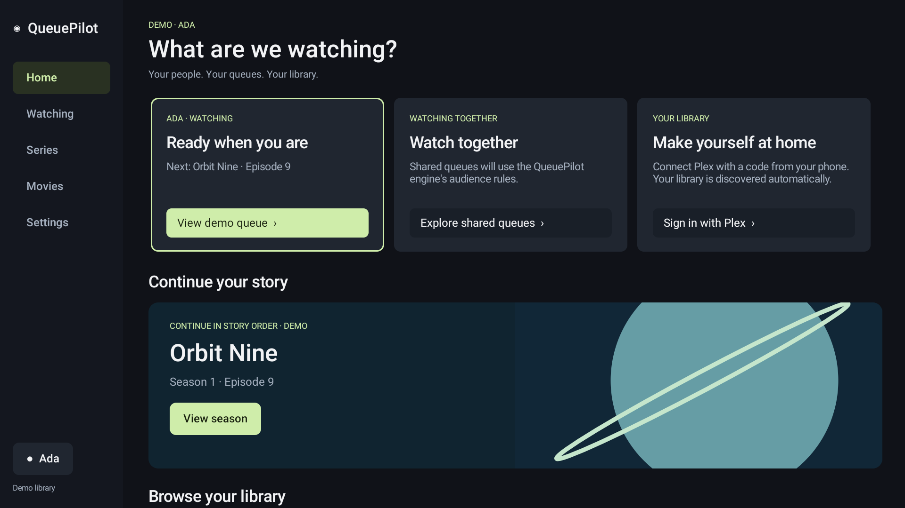
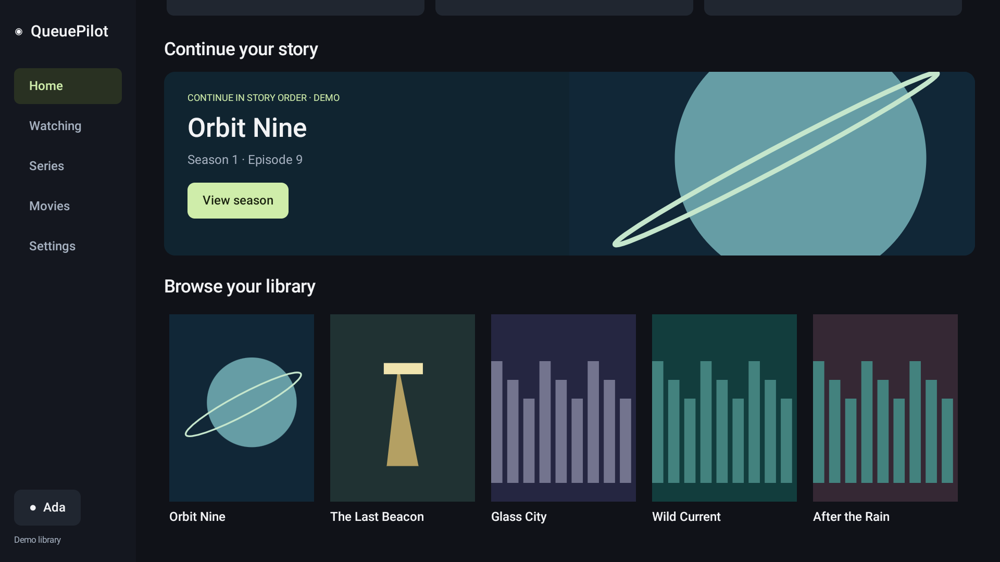
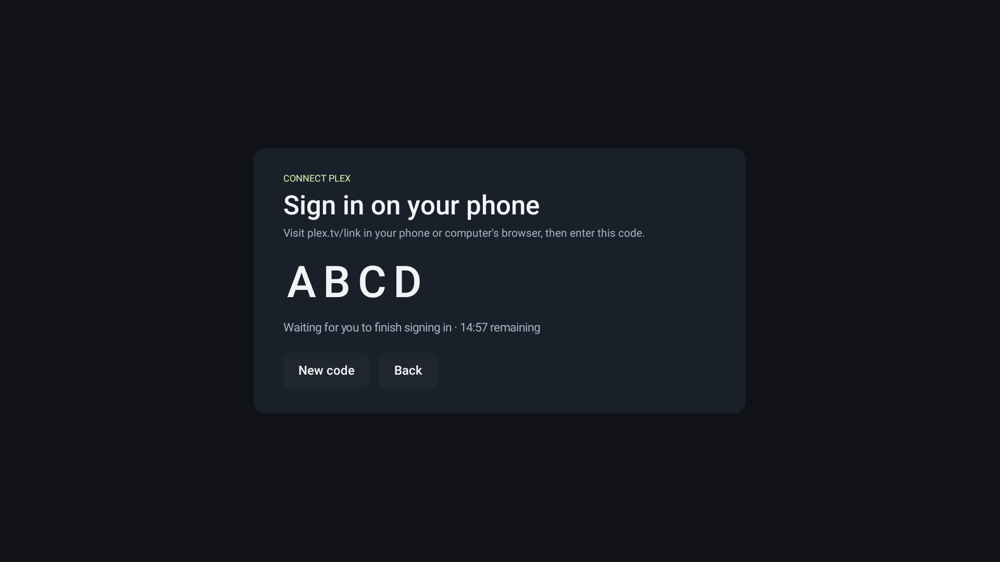
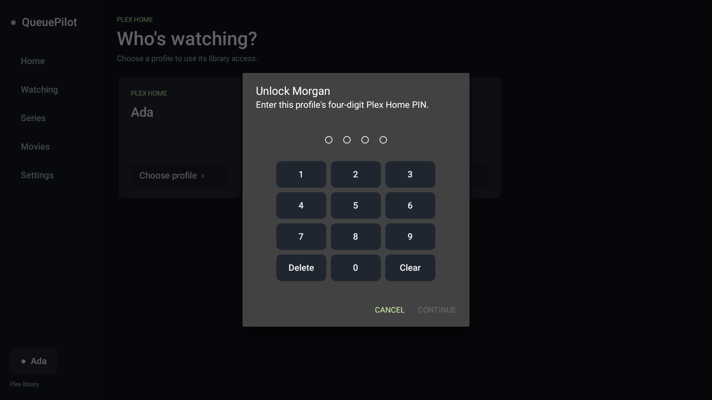

# Native TV presentation and Plex sign in

Version 0.2.0 replaces the diagnostic form with the approved queue-first native TV
presentation. The home screen has a left rail, compact queue cards, continuation, and
artwork browsing. Back preserves the route, and focused cards have visible outlines.
Plex setup uses a four-character link code, automatic Home profile discovery, and server
selection. Protected profiles use a bounded, remote-operated number pad.

## Validation

Ten Java unit tests and Android lint pass. Tests cover stable episode identity and
profile progress, authenticated origin constraints, and direct server connection policy.
The anonymous live Plex PIN endpoint returned a four-character code with a 900-second
expiry. Read-only authenticated probes confirmed the current user, Home roster, and
resource response shapes. Those probes did not sign the TV into an account.

The complete synthetic authorization and playback run passed on 2026-10-11, with no
fatal exceptions in the fresh emulator crash log. The reproducible check is `tools/smoke.py`.
They exercise code cancellation and expiry, protected-profile PIN rejection, automatic
server discovery, encrypted credential storage, server/profile token separation, direct
H.264/AAC playback, cast, cached profile/catalog access, Back navigation, D-pad focus,
and demo viewing-order persistence. The fixture uses invented accounts and media.
The test refuses physical-device targets. Fixture network routing is restricted to an emulator.

The Google TV API 30 image's numeric soft keyboard crashed while testing a protected
profile. The app now uses its own TV number pad, removing the soft keyboard from that flow.
The emulator has an isolated AVD and Android home; the APK build retains a separate
persistent signing key.

The container memory limit was raised from 6 GiB to 10 GiB after the software-rendered
emulator exhausted its initial allowance during repeated tests.

The screenshots below are from the native APK. They are not browser mockups.
The prior [0.1.0 diagnostic evidence](verification-0.1.0.md) remains as a historical record.

Native 1920 × 1080 layout checks passed at density 240 and density 320, including
D-pad focus, bounded controls, and scrolling through the artwork row. The latter matches
a common TV display scale.

APK SHA-256: `0d14ff6837871b571bd957c0296e2d10cb4c5727926570243264ec0fab698156`.

## Native screenshots

[Home at density 320](evidence/queue-home-1080p-320dpi.png) · [Cast overlay](evidence/cast.png)

## 4K experiment

The API 30 TV emulator was booted with a physical 3840 × 2160 display and density 480.
Android reported that physical mode but its window display override and PNG capture were
still 1920 × 1080. The strict native-resolution assertion failed, correctly preventing a
false 4K claim. At that density the 1080p app area was too small and the layout clipped.
This configuration is not a supported or verified native-4K environment. Changing only
`wm size` was also insufficient. Default 1080p layout testing remains separate from this
unresolved 4K experiment.

## Limits

Native QueuePilot starts, Plex watch-history updates, server transcode negotiation,
faithful large ASS subtitles, HDR conversion, and passthrough remain unfinished or
unverified. Emulator screenshots do not prove native 4K composition on a physical Shield.
Protected-profile switching currently requires an online PIN check. Cached unprotected
profiles cannot renew an expired token or play from an unreachable server.
