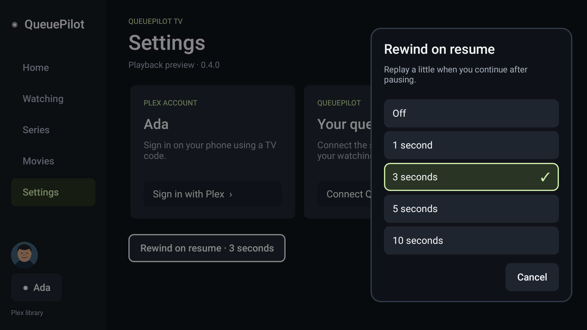
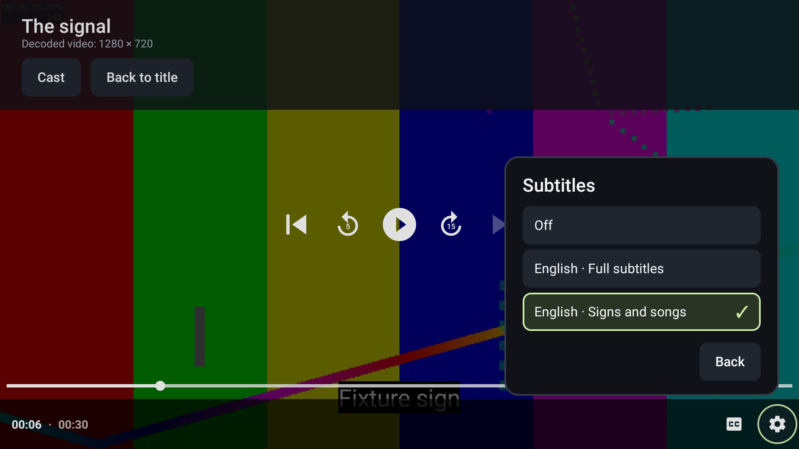

# In-app options and playback menus

Version 0.4.0-preview, version code 4. Verified 2026-10-12.

All 15 Java unit tests, Android lint and APK assembly passed. The complete emulator
sign-in/profile/library suite and native queue/history suite passed. Menu checks passed
at 240 and 320 dpi: selected values, D-pad navigation and cancellation, persisted rewind,
focus return, placement immediately above the launching bottom control, playback speed,
named audio/subtitle switching, duplicate unnamed audio labels and subtitle Off. Native
1920×1080 home and artwork browsing checks also passed at both densities. No fatal Java
exception was recorded. Fixtures are fictional; no physical-device installation is
implied by these emulator checks.

APK SHA-256: `990119887d1e71aeea16a1710efd8cf46f85cf3ee66951aac60966e7e369dc36`.

This change styles options and changes actual playback selections. ASS rendering is
unchanged in this version and remains a separate renderer requirement.
