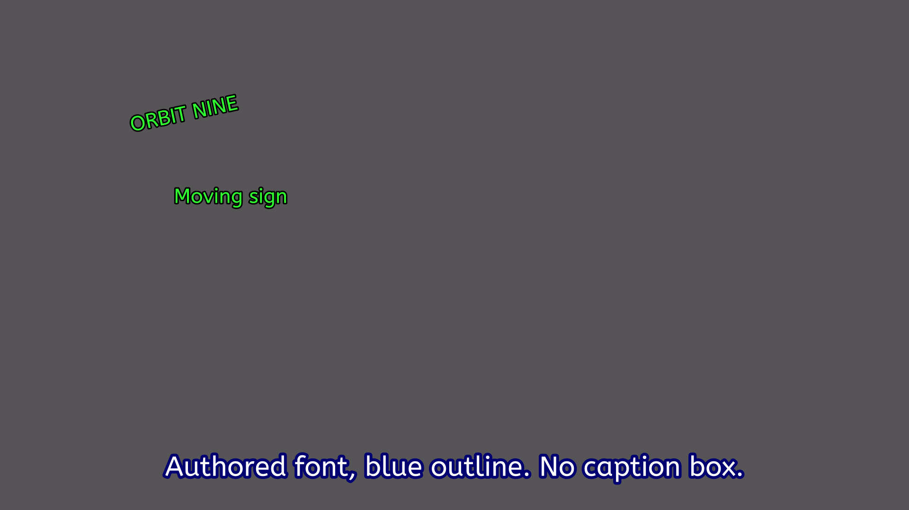

# Native ASS rendering verification

Version 0.5.0-preview, version code 5. Verified 2026-10-12.

Embedded Matroska ASS now uses libass alongside Media3 audio/video. Attached fonts,
authored font size, color, outlines, positioning, rotation, drawings and animation
reach the subtitle compositor without conversion to plain captions. Playback options
retain the in-app panels verified in version 0.4.0.

All 18 Java unit tests, Android lint and APK assembly passed. Native dependencies built
from pinned upstream source for ARM64, ARMv7 and x86. The fictional ASS fixture compares
against an independently rendered FFmpeg/libass reference: 99.8% blue-outline mask
overlap, mean RGB error 1.964 in the caption region. Authored fonts, positioned and
rotated signs, animation, Off, ASS/SRT/ASS switching, re-enable while paused, backward
seek while paused and playback after seeking passed.

The complete emulator regression passed: device-link sign-in, profiles, library/cache,
native queues, people filtering, cast, history and restart. In-app menu and layout
checks passed at 240 and 320 dpi, including playback speed, named audio/subtitle
selection, Off, D-pad cancellation/focus return and configurable resume rewind.

Physical Android TV validation used a large embedded ASS track and attached fonts.
A paused seek displayed the authored font and outline at the reference dialogue;
Off/On and a dense vector-sign sequence also worked. These were sampled scenes,
not a full-film endurance test. Private media evidence is kept outside this repository.

## Known limits

This renderer covers embedded ASS in Matroska. A fresh seek into a previously unseen
cue that began more than five seconds earlier may still miss that cue; complete
subtitle indexing is not implemented. External ASS and other containers use the
existing path. Font limits and native-source/relink instructions are documented in
[ASS rendering](ass-rendering.md). Native 4K UI, HDR conversion and audio passthrough
are not established by these subtitle tests.

APK SHA-256: `c3a194b27115b1ad59bf47946616e870409b836866265805d6f6ffb6a371cb83`.
Distribute the corresponding native-source/relink archive alongside this APK.
