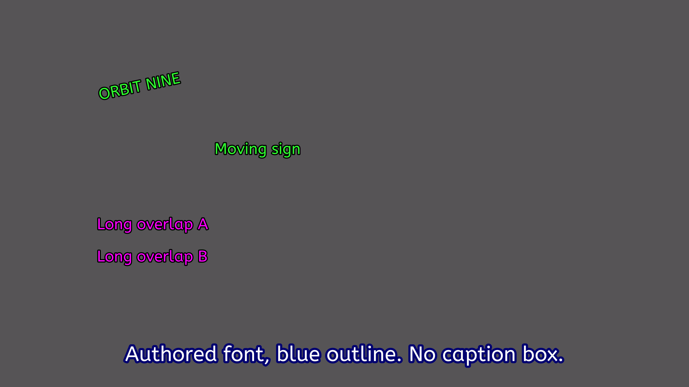

# Long ASS cue seek recovery

Version 0.5.1-preview, version code 6. Verified 2026-10-12.

A five-second container pre-roll cannot restore a subtitle that began minutes earlier.
The player now queries overlapping Matroska subtitle cues, reads their original packets,
and submits them at their authored time in Media3's renderer timeline. Recovery includes
all overlapping layers and cues already pruned from the native renderer.

All 22 unit tests, Android lint and APK assembly passed. Index tests cover overlaps,
exclusive end times, track isolation, missing CueDuration recovered from BlockDuration,
raw ASS overrides and commas, and malformed/truncated blocks. The full emulator
regression passed: sign-in/profile/cache, native queues and history, and control-anchored
menus and native layouts at 240 and 320 dpi.

The visual fixture cold-resumes at 60 seconds, inside cues beginning at 0, 20 and 30
seconds. It then seeks beyond the two shorter cues' expiry plus the native retention
window, and returns while paused. Both overlaps reappear, including after Off/On.
The authored-font reference still matches at 99.8% outline-mask overlap and mean RGB
error 1.964. Expired cues disappear. Generation guards prevent stale seek results from
being displayed, and recovery uses at most one packet waiting for the native worker.

Physical Android TV testing recovered a real file's long ending-song cues after a fresh
seek, then restored earlier dialogue after the native renderer had pruned it. Private
media/screenshots remain in deployment notes. These are sampled scene tests, not a
full-film endurance, HDR, passthrough or native 4K UI certification.

Recovery applies to embedded Matroska ASS with subtitle Cues and block-relative
positions. Unindexed files retain streamed decoding and existing pre-roll; a whole-file
index builder is not included. See [ASS rendering](ass-rendering.md).

APK SHA-256: `0d7d07d7cae095cf9ae607da1a3a45018f34a35ee9c50db1a9a782c21f7f6680`.
Ship the corresponding native-source/relink archive with this APK.
