# Queues first, show names, skip markers and Display size

Version 0.5.2-preview, version code 7. Verified 2026-10-23.

The launcher label is now **QueuePilot**; the application ID is unchanged, so this updates
the installed preview in place. `aapt2 dump badging` reports
`package: name='dev.queuepilot.player.prototype' versionCode='7' versionName='0.5.2-preview'`
and `application-label:'QueuePilot'`.

Rewind on resume is Off by default. A stored choice of 1, 3, 5 or 10 seconds is kept. The
native check resumes within a few milliseconds of the paused position with the default, and
three seconds earlier after choosing three seconds.

The Cast overlay now shows faces and actors for episodes. Many libraries keep the cast
only on the show, so an episode lists its own guest roles first, then its season's and
show's, once each. Portraits load through the server's image transcoder, which also serves
external HTTPS portrait URLs; a portrait the server cannot fetch is requested directly
without credentials. The fixture's episodes carry no Role of their own, and one portrait is
an external URL that only the transcoder can serve. Both faces render on the library and
queue paths.

Plex intro and credits markers show **Skip Intro** or **Skip Credits**. The button takes
D-pad focus without pausing and seeks to the marker end. Final credits finish the title:
Plex receives a stopped timeline past 90% and a queue moves to its next item. Skips stay
inside an authored queue section.

Episodes are named by their show, then "S1 · E9 · Title", on cards, the title screen, the
player overlay (including after the next queue item starts) and the continue cards. Home
continues the saved queue first and names its queue, show and episode; the server's own
on-deck card names the server, not the provider.

Home leads with every queue. Queues that play as the active profile come first, then the
ones that switch profile, each in the server's order and each card naming its audience
("Ada, Grace") and, when it switches, the profile. Same-titled fixture queues ("Movies" for
three audiences) are told apart this way. An active people filter says "Showing N of M
queues" with a one-press Clear. The rail keeps only the avatar ("Switch profile, Ada"). The
profile picker shows **🔒 PIN** and **Owner** instead of "PLEX HOME" on every card.

**Display size** scales everything through one factor at the dimension layer, and the base
type is 14% smaller at 100%. The invented Films grid has 7, 5 and 4 columns at 70%, 100%
and 125%. The choice persists across a restart and applies at once. A focused poster still
draws its outline at every size, and every visible label stays on screen, at density 240
and at 1080p density 320. Posters and artwork have square corners. A long title on the title
screen wraps to two lines and ends in an ellipsis; a long summary is four lines, and **More**
opens the full text.

| Before (0.5.1) | After (0.5.2) |
| --- | --- |
| 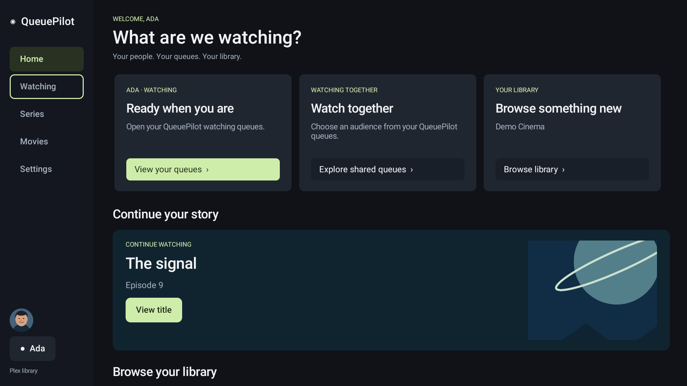 | 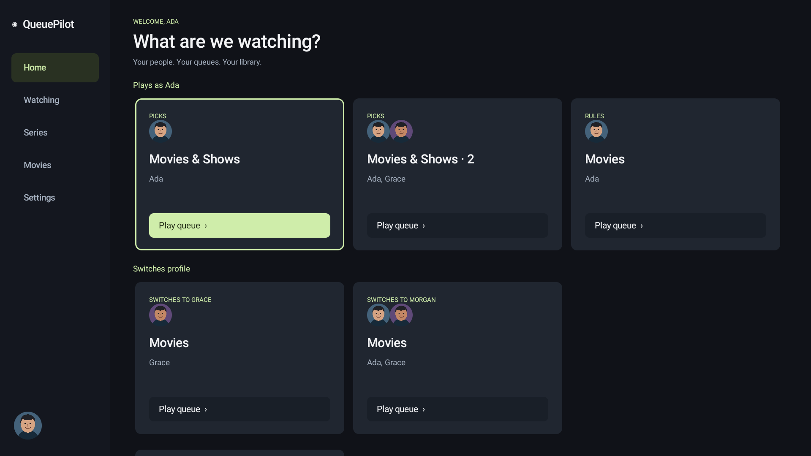 |
| 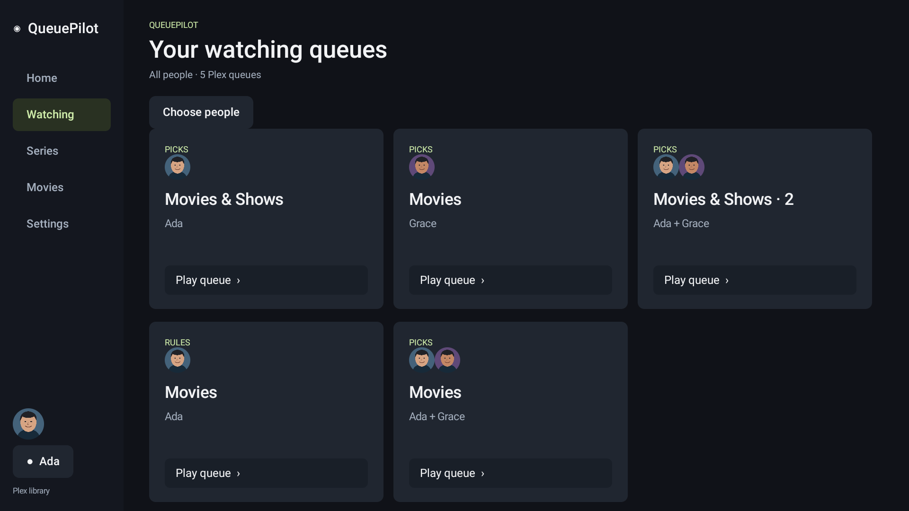 | 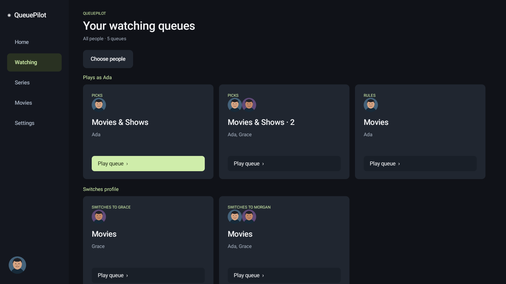 |
| 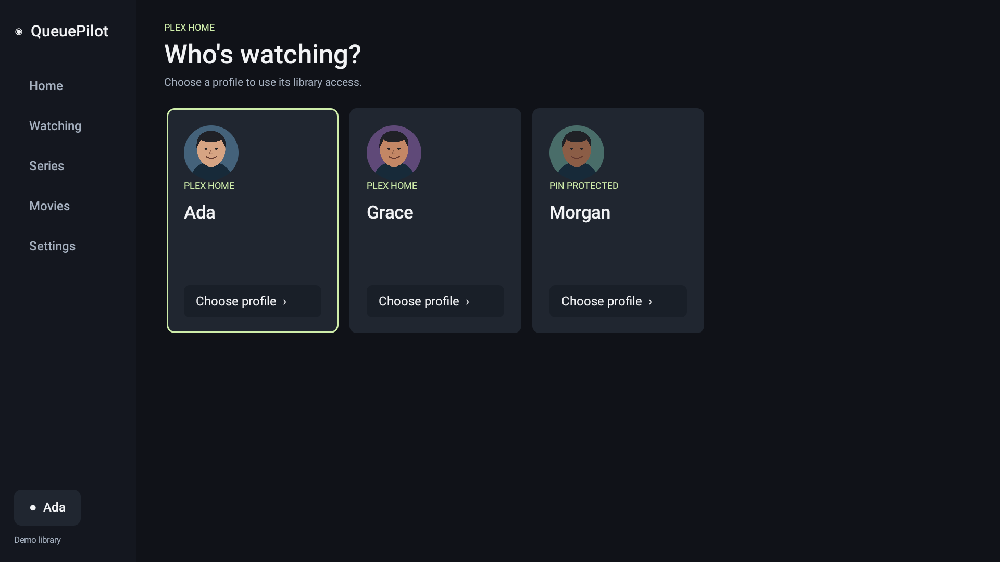 | 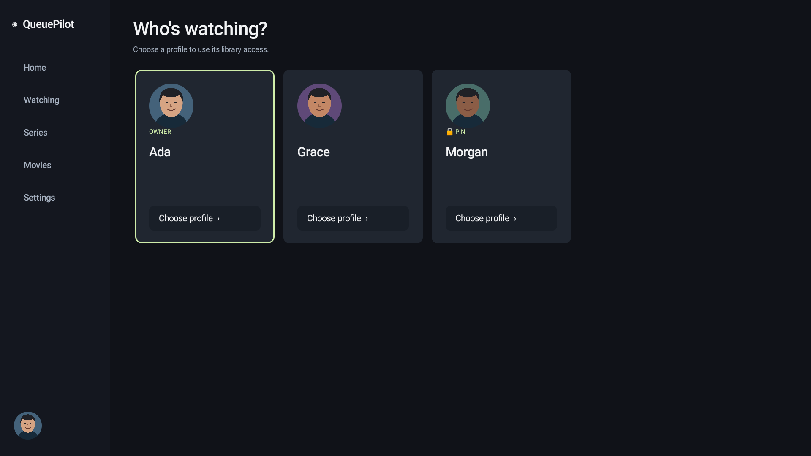 |

The before and after pairs were taken in the same emulator at the same density, with 0.5.1
installed over 0.5.2 and then replaced.

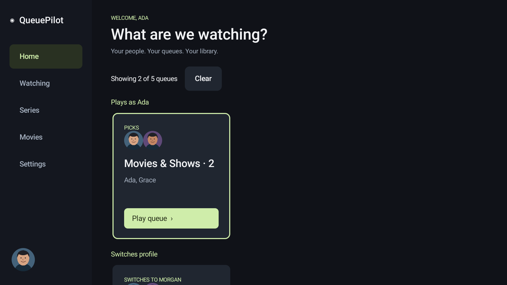

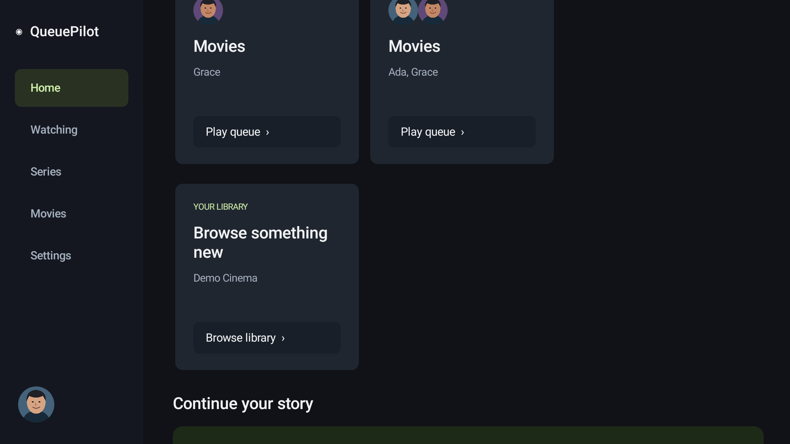
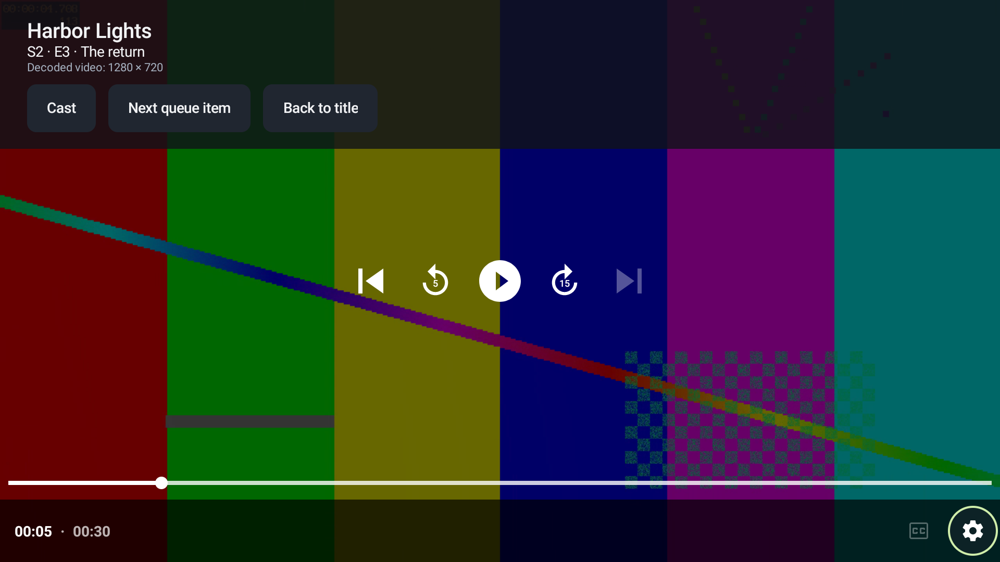
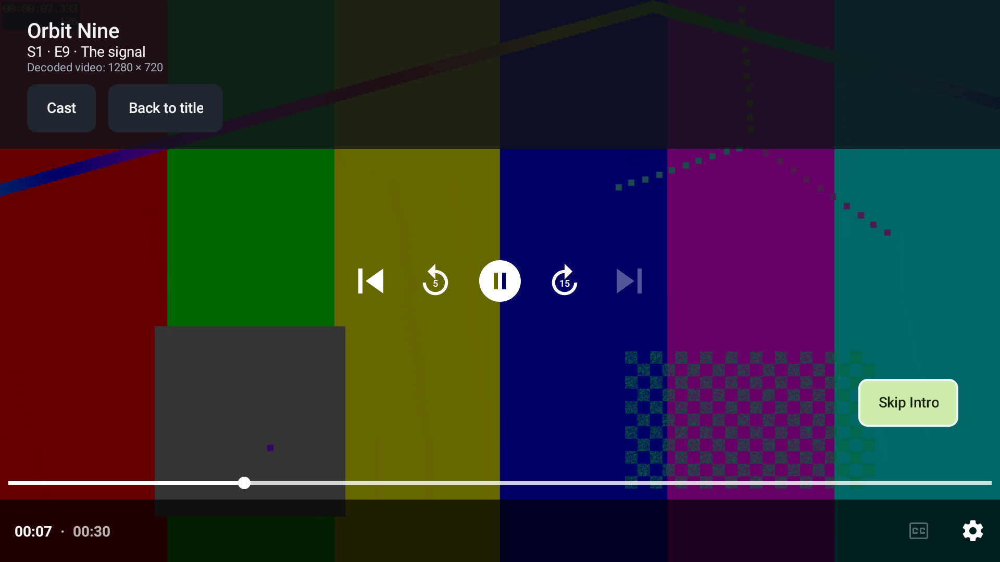
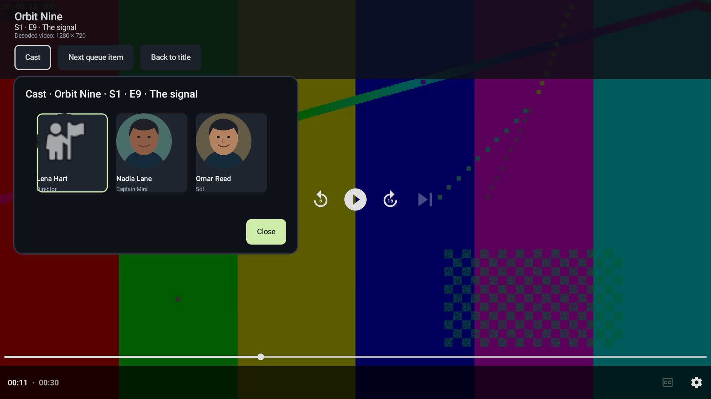
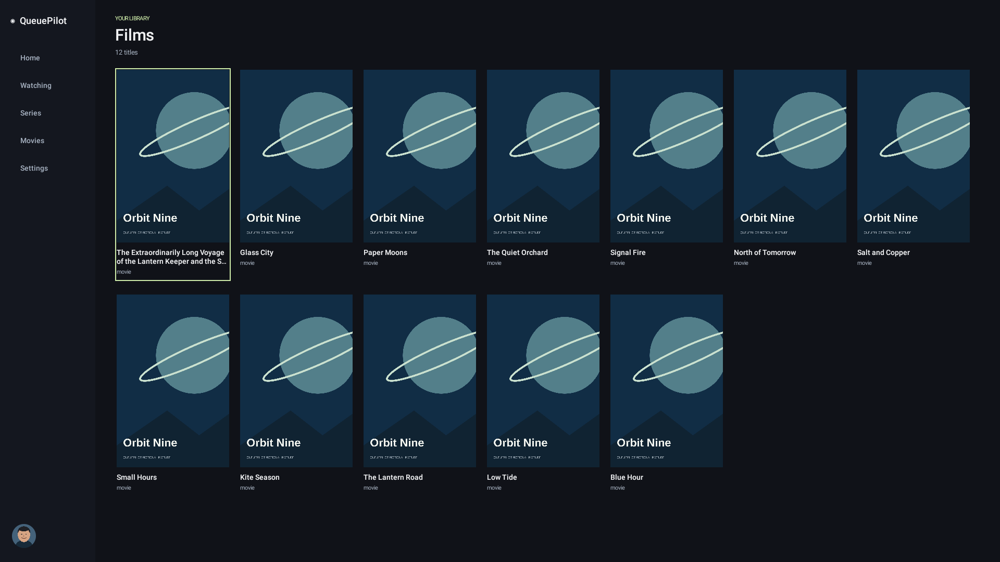
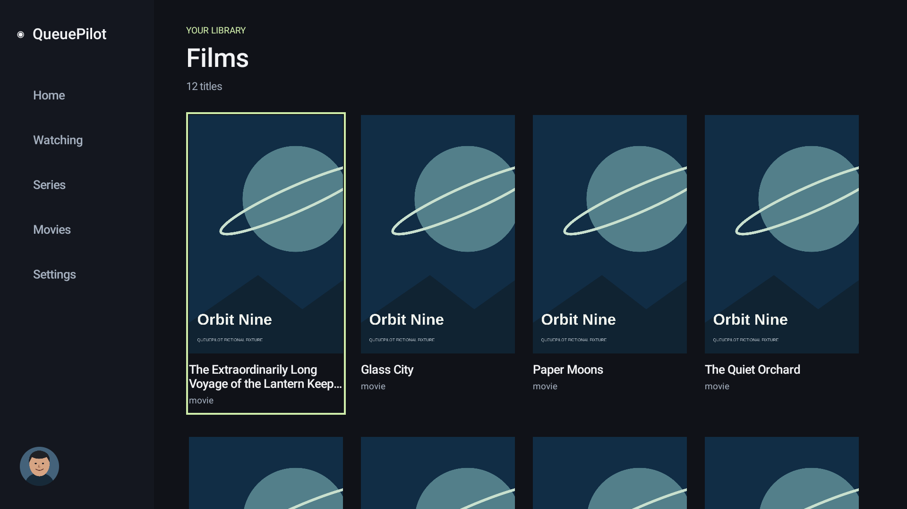
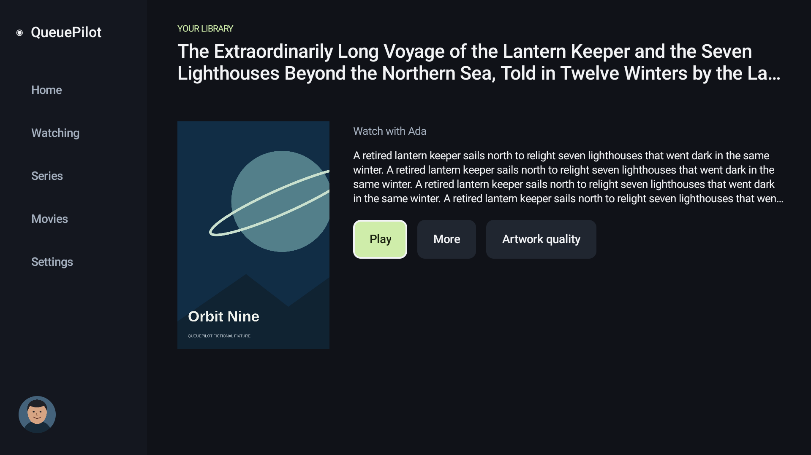

All 49 unit tests, Android lint (0 errors) and APK assembly passed. The full emulator
regression passed: `smoke.py`, `native_smoke.py`, `panels_smoke.py`, `markers_smoke.py`,
`labels_smoke.py`, `display_smoke.py` at both densities, and `layout_smoke.py` at both
densities. Screenshots show invented fixture data only.

Not verified: the eight-second auto-hide of the skip button, the credential-free direct
portrait fallback against a real external host, Media3 control scaling beyond a visual check,
and any physical Android TV. No physical device was used for this release.

APK SHA-256: `c04e0918ff096a5d82cd0d111f1ea3e59568a9820e5ec78ee0a4ef0f71968f09`.
Ship the corresponding native-source/relink archive with this APK.
