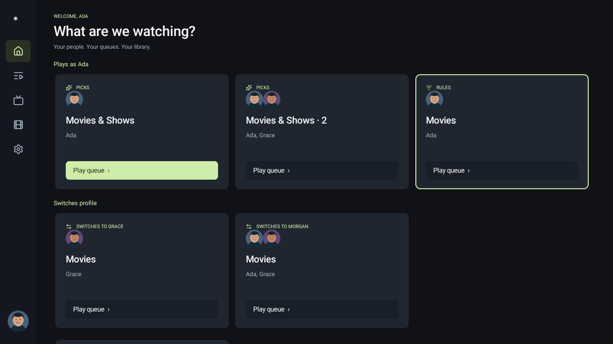
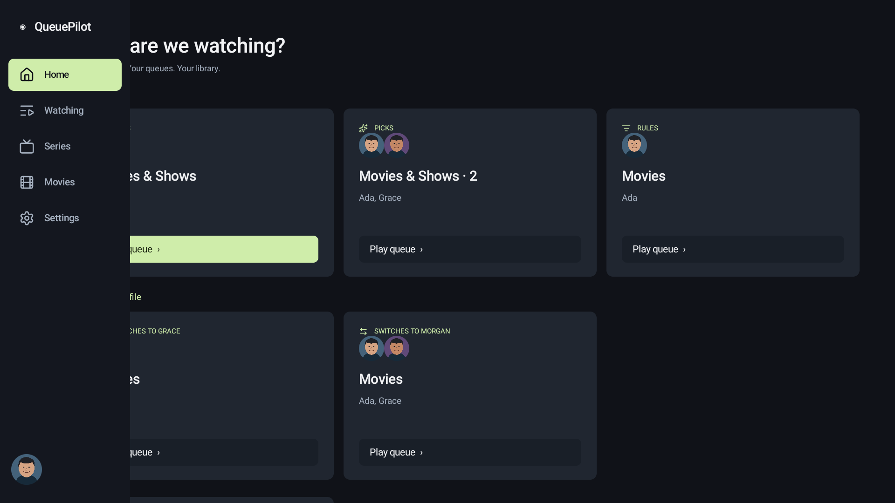
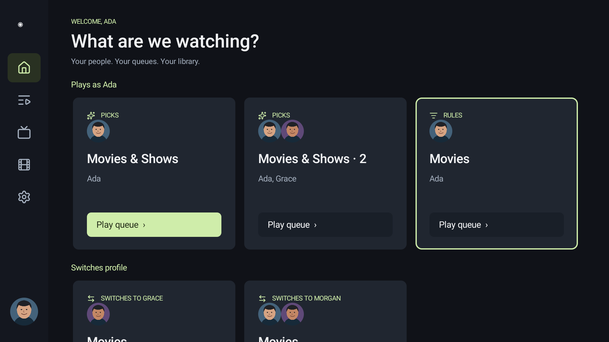
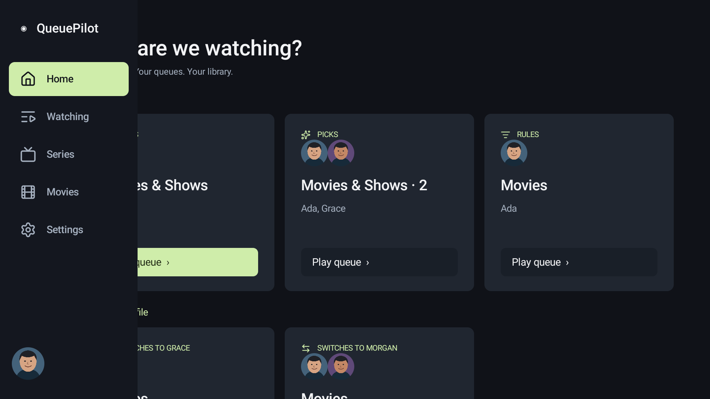
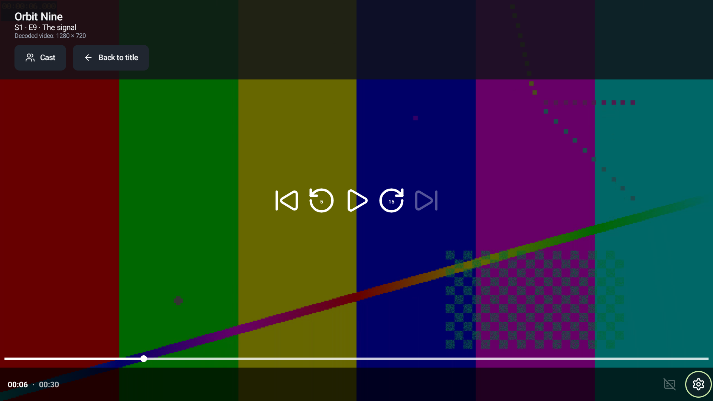
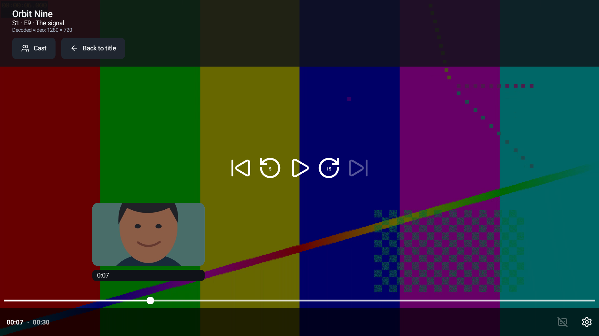
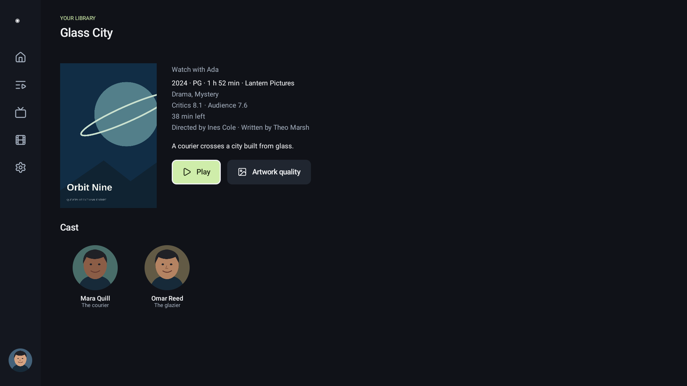
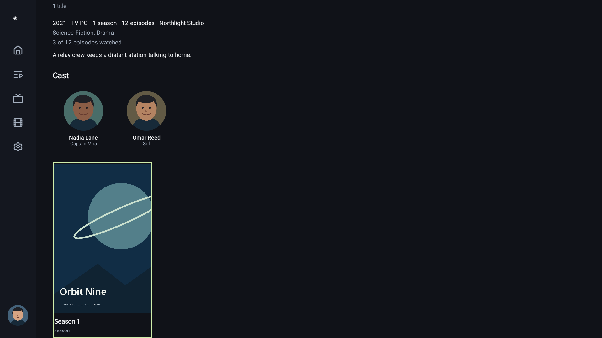

# Icon rail, Lucide icons, seek thumbnails and title facts

Version 0.5.3-preview, version code 8. Verified 2026-10-23.

`aapt2 dump badging` reports
`package: name='dev.queuepilot.player.prototype' versionCode='8' versionName='0.5.3-preview'`,
`targetSdkVersion:'36'` and `application-label:'QueuePilot'`. The application ID is
unchanged, so this updates the installed preview in place.

## Navigation rail

The rail is drawn over the content and collapses to icons while focus is in the content.
Moving left onto it expands it with labels in 120 ms; it is drawn over the grid, so the grid
never reflows. Left lands on the selected entry, not the nearest one. Down from Settings
reaches the profile avatar. Right returns to the content and collapses the rail. Back from
the content of a top-level screen (Home, Watching, Settings, a library list) returns to the
rail instead of leaving the screen. Every entry has a Lucide icon and a spoken name, and the
rail says whether it is expanded. A focused entry is filled with the accent and draws its icon
and label in the background color. Series and Movies stay separate entries.

`rail_smoke.py` checks this at the emulator density and at 1080p density 320. It measures the
collapsed width (76 dp) and the expanded width (186 dp), and it decodes a screencap to prove
that each collapsed entry draws an icon while its label is hidden.

| Collapsed | Expanded |
| --- | --- |
|  |  |
|  |  |

## Lucide icons

Thirty-one Lucide icons are vendored from the `lucide-static` 1.61.0 npm release, checked
against the registry integrity hash, and converted to Android vector drawables by
`tools/lucide/generate.py`. `tools/lucide/LICENSE` carries the Lucide ISC license and the MIT
license of the Feather icons it derives from. Every icon keeps Lucide's one 2-unit stroke and
is tinted with an existing color; no color or type style was added.

Icons appear on the rail, the Media3 player controls (previous, rewind, play and pause, fast
forward, next, subtitles, settings, audio, speed, fullscreen, and menu checks), Skip, Cast and
Back to title, the queue card labels (Picks, Rules, Switches to), the Settings cards and rows,
the title actions (Play, More, Artwork quality, Cast, Choose people), and the library tiles.
`details_smoke.py` checks that each visible player control has a spoken name and carries no
text label other than the seek interval.

## Seek thumbnails

When Plex reports an `sd` index on the playing Part, the first scrub fetches
`/library/parts/<id>/indexes/sd`. `BifIndex` rejects a file over 32 MB and checks every
header value, index entry, timestamp and frame offset before it accepts a file; a file that
does not hold together is ignored and the time is shown alone. While the time bar is moved by
touch or by D-pad, a rounded preview of the frame for that time sits above the bar with the
time beneath it, clamped inside the screen and inside an authored queue section. Only the
frame on screen is decoded.

The fixture serves a seven-frame BIF, one frame every five seconds, each a different invented
portrait. `details_smoke.py` checks that nothing is fetched until the viewer seeks, that the
index is fetched once, that the frame named in the preview matches its time, and that the
preview sits above the bar inside the screen. Unit tests cover valid files, a multiplier, a
zero multiplier, frame lookup, six truncation points, seven malformed layouts, and the size
limit.

## Title facts

A film or episode title screen reads the title's full metadata and shows the year, content
rating, runtime, studio, genres, critic and audience scores, time left or watched state,
director and writers, and a cast row with portraits and roles. A show's season list and a
season's episode list start with that show's or season's facts, summary, and cast.

| Film | Show |
| --- | --- |
|  |  |

Closed against the Plex 2026.19.1 title screen: year, content rating, runtime, season and
episode counts, studio, genres, critic and audience scores, time left, episodes watched,
director, writers, cast with photos, and show and season summaries.

Not closed: per-episode watched marks and runtimes in episode lists; a seasons row on the title
screen itself (the show's facts sit above its season list instead); reviews, discussions,
theme music, trailers and extras, which the Plex inventory lists as online or optional detail
features; and the Plex Seek Back and Seek Forward Time settings. The seek preview follows the
time bar only; the rewind and fast-forward buttons jump without a preview.

## Gates

All 60 unit tests, Android lint (0 errors) and APK assembly passed. On a freshly started lab,
the full emulator regression passed: `smoke.py`, `native_smoke.py`, `panels_smoke.py`,
`markers_smoke.py`, `labels_smoke.py`, `display_smoke.py` at both densities, `rail_smoke.py`
at both densities, `details_smoke.py`, and `layout_smoke.py` at both densities. Screenshots
show invented fixture data only.

Not verified: the 120 ms rail animation is set in code and not measured; seek thumbnails
against a real Plex server's BIF; the direct-portrait fallback against a real external host;
and any physical Android TV. No physical device was used for this release.

APK SHA-256: `4de18f49c1674b948f4ae2bc01845badfee2d1ca3fe88af7059cb54234c5f430`.
Ship the corresponding native-source/relink archive with this APK.
