# Full queue and watch history

Version 0.5.4-preview, version code 9. Verified 2026-10-23.

`aapt2 dump badging` reports
`package: name='dev.queuepilot.player.prototype' versionCode='9' versionName='0.5.4-preview'`,
`targetSdkVersion:'36'`, and `application-label:'QueuePilot'`. The application ID is
unchanged, so this updates the installed preview in place.

This release builds the two selected designs against QueuePilot's native API:
`GET /api/native/queues/:setId/full`, `POST /api/native/sessions` with `start`,
`POST /api/native/queues/:setId/watched`, and `GET /api/native/history`. Every request carries
the `X-Plex-Profile-Token` the app already sends to the session routes. It uses the 0.5.3
colors and type styles; the restyle is not chosen yet, so nothing new has a color of its own.

## Full queue

Every queue card on Home and Watching has a **Full queue** action beneath it, the Home resume
card has one beside **Resume queue**, and the player shows one while a queue plays. The
player's action reports a stopped event and opens that queue's list; Back then returns to
where playback began.

| Queue cards | Player |
| --- | --- |
| 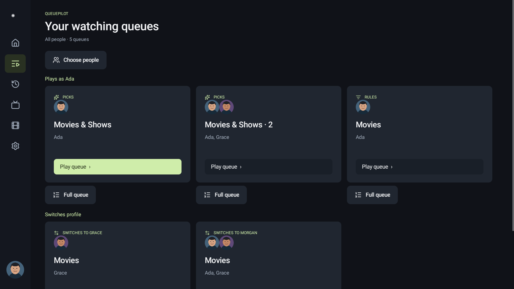 | 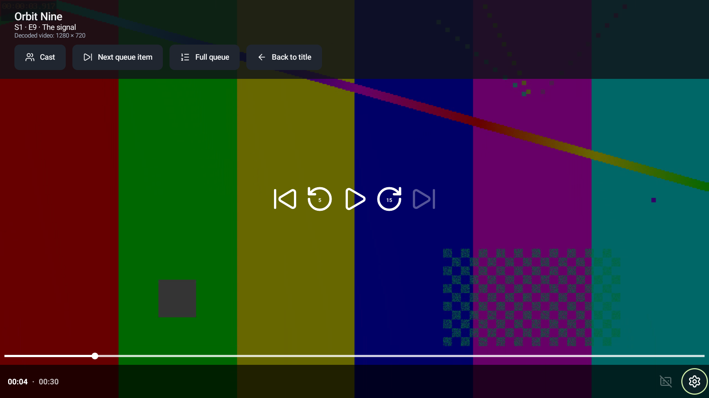 |

The page lists the whole ordered queue, not only tonight's lineup. The layout is the server's
`layout` value, chosen from the queue's content, and there is no switch:

- **list** (design 1A) for a queue of mostly episodes: one row per item with its position, a
  square-cornered picture, the title, the show, season and episode, and the length. It opens
  at the next item with the watched items folded behind **Show N watched items**.
- **grid** (design 1B) for a queue of mostly movies: a picture card per item; watched cards
  stay in place, dimmed. The column count follows Display size.

Each item's badge states its state in words and an icon: **Watched**, **In progress · N min
left** with a progress bar, **Next**, an authored **Section 41:10 to 58:30**, or **Special**.
A heading names each entry ("Entry 2 of 3", Priority, Shuffled, or not found on the server).
"Tonight's lineup · starts at your next item" sits before the next item, and **Tonight's
lineup ends here** follows the item at `lineup.endPosition`, with the lineup's item count and
time.

Selecting an item opens a side panel:

- **Start here, then continue** and **Play only this item** send `start` with `mode`
  `continue` or `only`. The panel says that earlier unwatched items stay in the queue; the
  server leaves them unwatched. When an "only" item finishes, the app returns to the full
  queue and keeps the queue's place on Home, because one item is not the end of the queue.
- **Mark watched** / **Mark unwatched** appears only where `canMarkWatched` is true. An item
  whose watched state the media server keeps says so instead.
- A **Rules** queue lists its current lineup, offers no Start here, and says why: it chooses
  its own order each time. The server would answer 409.
- A queue that plays as another profile asks for the profile switch instead of failing.

| 1A, list | 1A, watched shown |
| --- | --- |
| 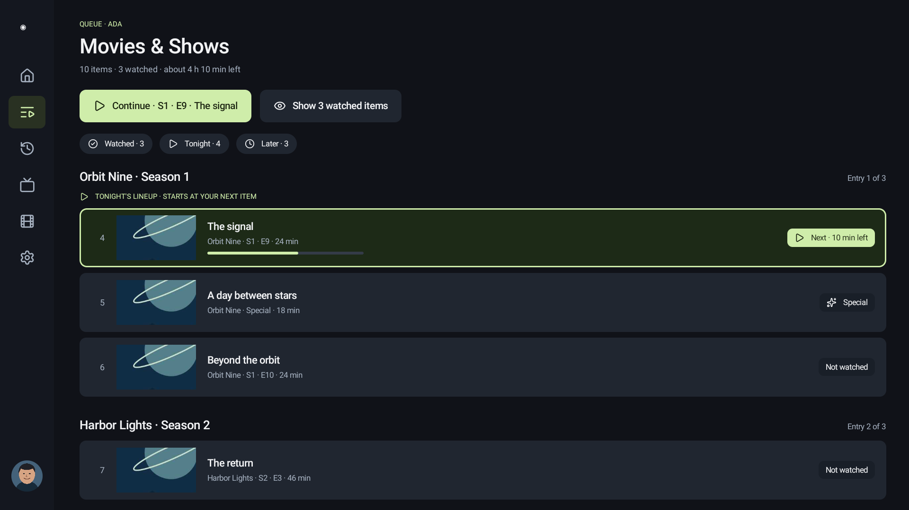 | 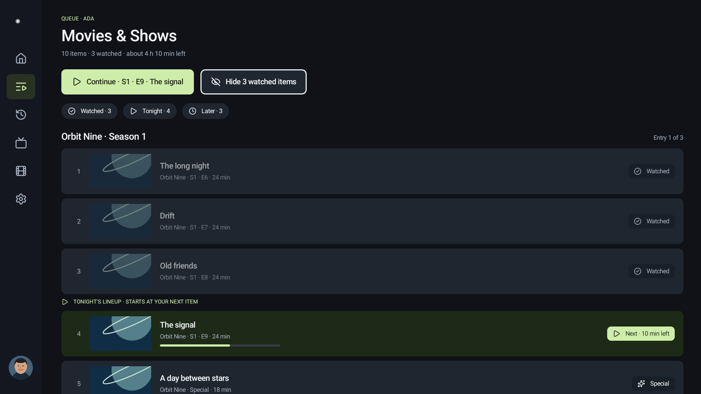 |

| 1B, grid at 100% | 1B, grid at 125% |
| --- | --- |
| 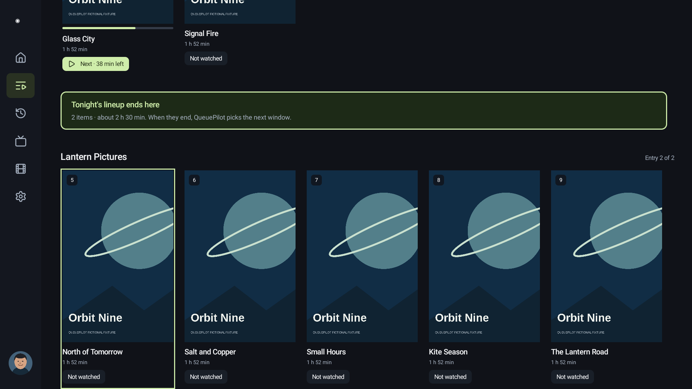 | 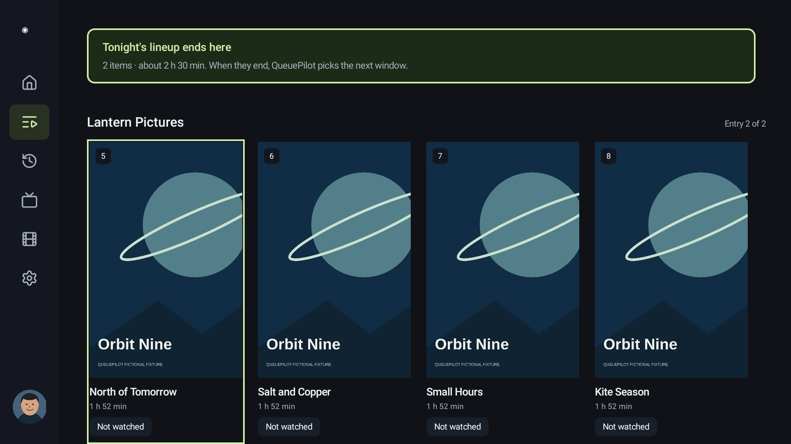 |

| Item panel | Refusals |
| --- | --- |
| 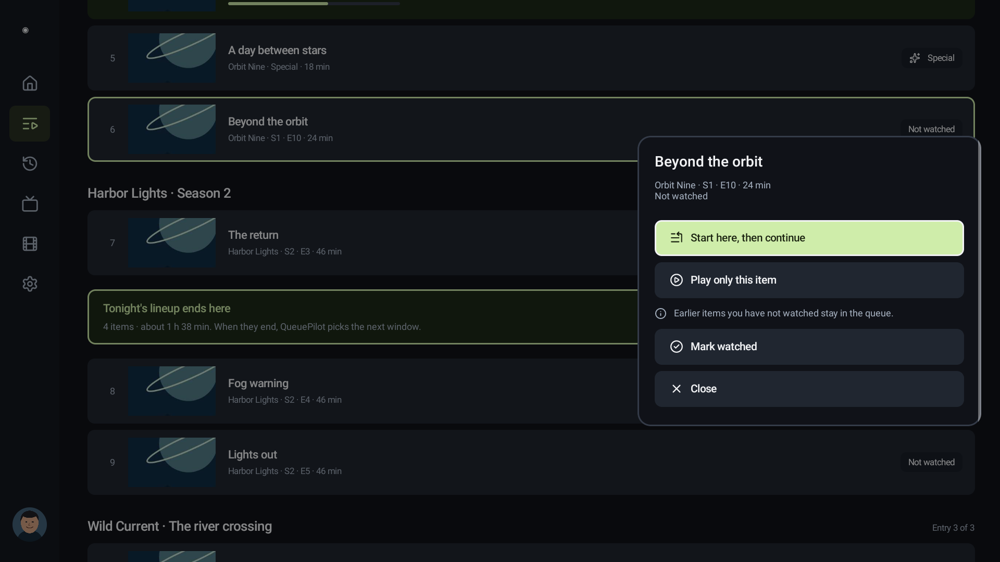 | 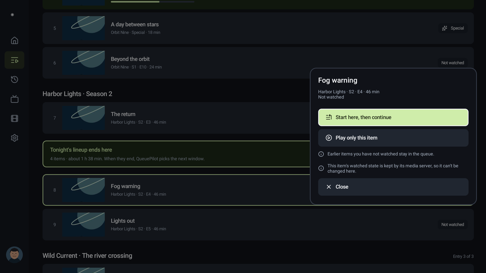 |

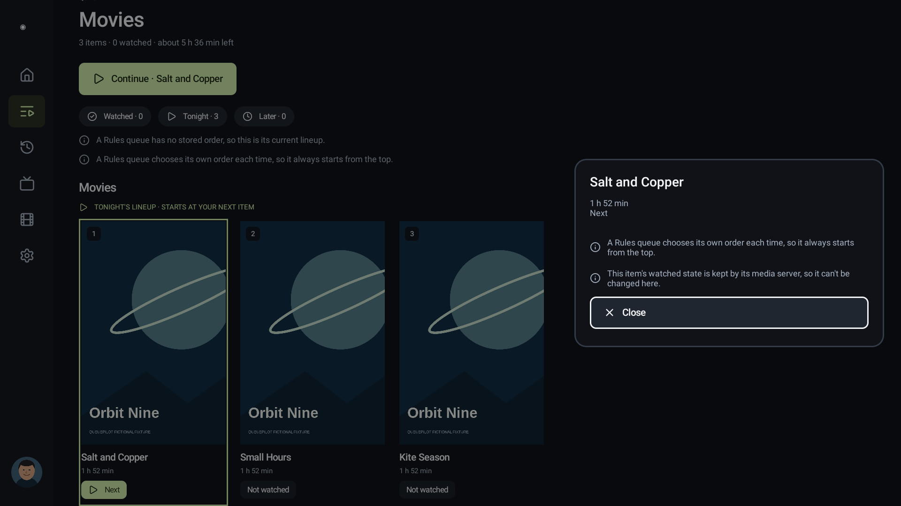

## Watch history

**History** is a rail entry between Watching and Series (design 2B). It shows the profile's
watching from `GET /api/native/history`, organized by queue, then by sitting, then by what was
watched. A queue heading names its sittings and when it was last watched, with its Full queue
action. A sitting card shows up to three pictures, the day and time span, the queue, each item
with a finished or partly-watched icon and percentage, its item count, and its length.
History includes plays in other apps only when a queue tracks them; the server already
filters, and the page states it. A queue-ledger item reads "Recorded by the queue". A sitting
with a play recorded before exact times were kept (`isTimeApproximate`) reads "about" before
its time and "times are approximate" in its footer.

Selecting a sitting opens a side panel: **Continue the queue**, **Play** for each of its items
(a Picks queue only), and **Open the full queue**. The period button chooses 7, 30, 90, or 365
days.

| History | Sitting panel |
| --- | --- |
| 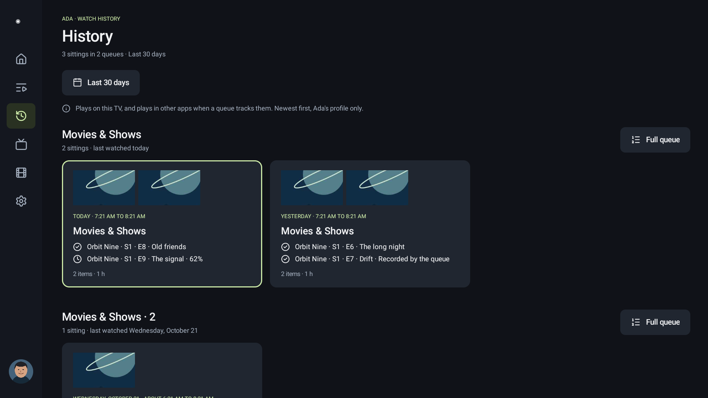 | 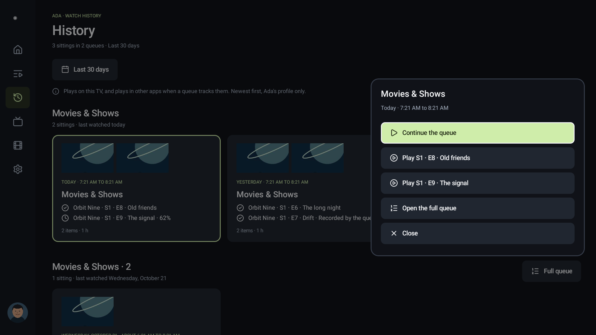 |

The rail now has six entries. At 1080p, density 320, and 125% Display size, the rail and its
avatar are taller than the screen, so the rail scrolls to the focused entry.

## Lucide icons

Twelve icons were added through `tools/lucide/fetch.sh` and `generate.py` from the same
pinned `lucide-static` 1.61.0 release: calendar, circle-check, circle-play, clock, eye,
eye-off, history, info, list-ordered, list-start, undo-2, and x. They mark the History entry,
the Full queue actions, the item states, the panel actions, the fold toggle, and the notes.

## Gates

All 68 unit tests, Android lint (0 errors), and APK assembly passed. On a freshly started lab,
the full emulator regression passed: `smoke.py`, `native_smoke.py`, `panels_smoke.py`,
`markers_smoke.py`, `labels_smoke.py`, `display_smoke.py` at both densities, `rail_smoke.py`
at both densities, `details_smoke.py`, the new `queue_history_smoke.py`, and `layout_smoke.py`
at both densities. `queue_history_smoke.py` drives both layouts, the fold, Start here in both
modes, both watched marks, both refusals, the player action, the Rules queue, the
profile-switch notice, and History with its period choice, and it asserts the requests the
fixture server received. The grid had 5 columns at 100% and 4 at 125%. Screenshots show
invented fixture data only.

After that run, the signed-out notice on the two new screens changed from "Sign in with Plex"
to "Sign in", to keep their text source-neutral. The final APK below then passed the 68 unit
tests, lint (0 errors), assembly, `smoke.py`, `native_smoke.py`, and `queue_history_smoke.py`.

Not verified: the queue and history screens against the live QueuePilot server and a real
library, sitting pictures from a real server's `/library/metadata/<id>/thumb`, and any
physical Android TV. No physical device was used for this release. The in-player Up next
panel from the selected designs is not built; the player has the Full queue action instead.

APK SHA-256: `63a63889723ba6d7c58ad036247968ed2d4f4053da783813ba677428054db512`.
Ship the corresponding native-source/relink archive with this APK.
