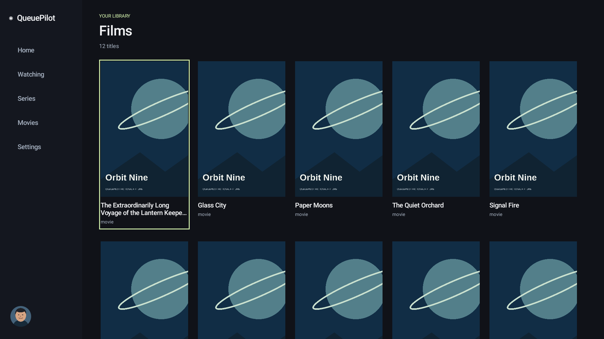
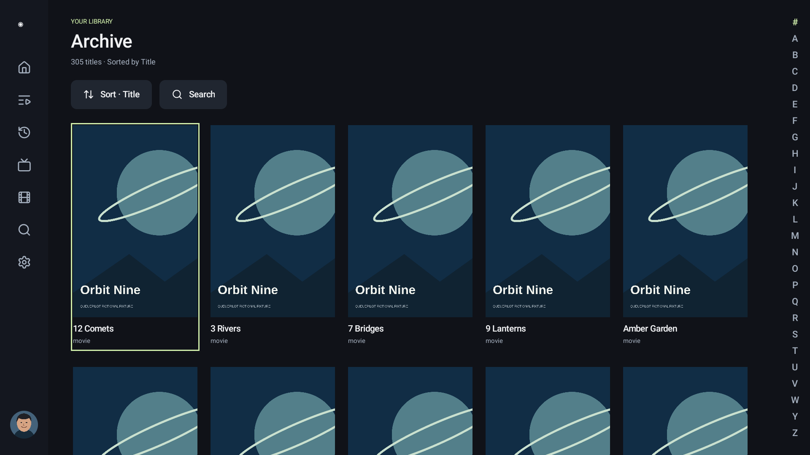
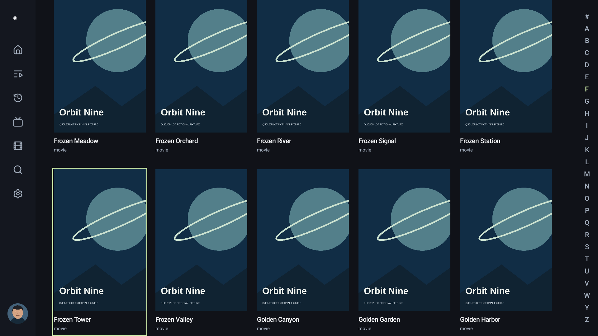
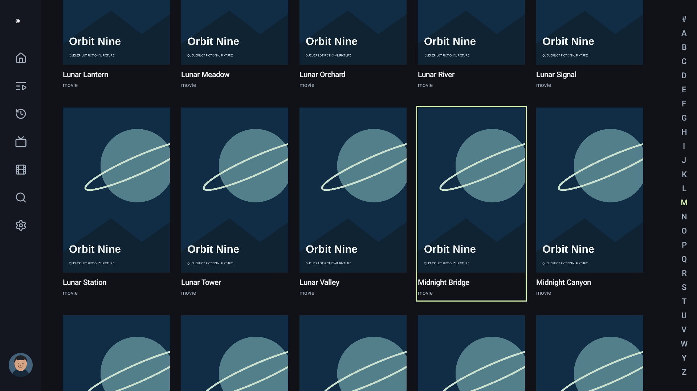
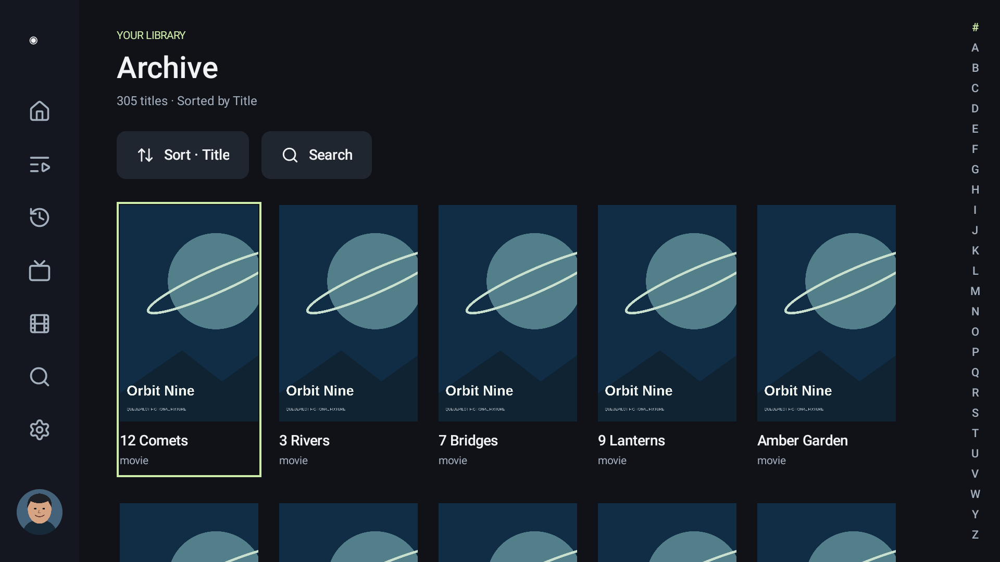
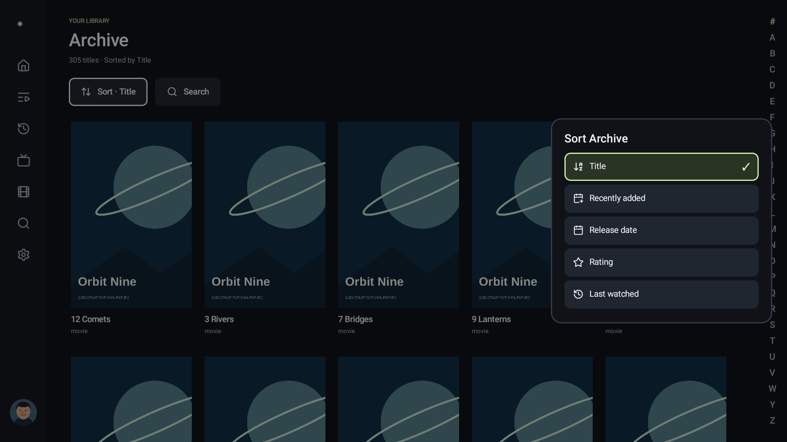
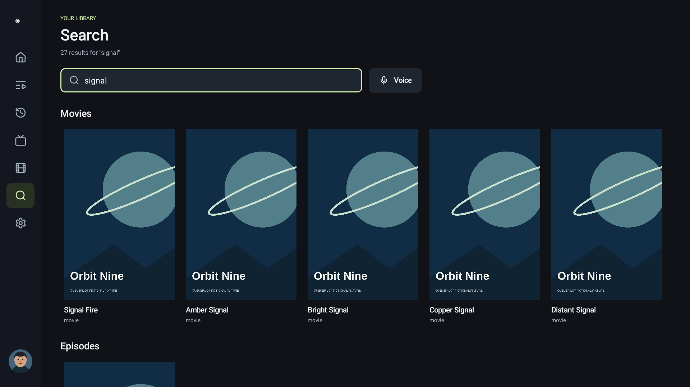
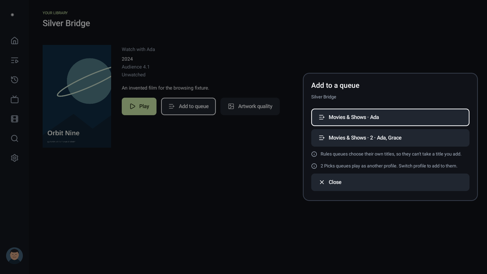
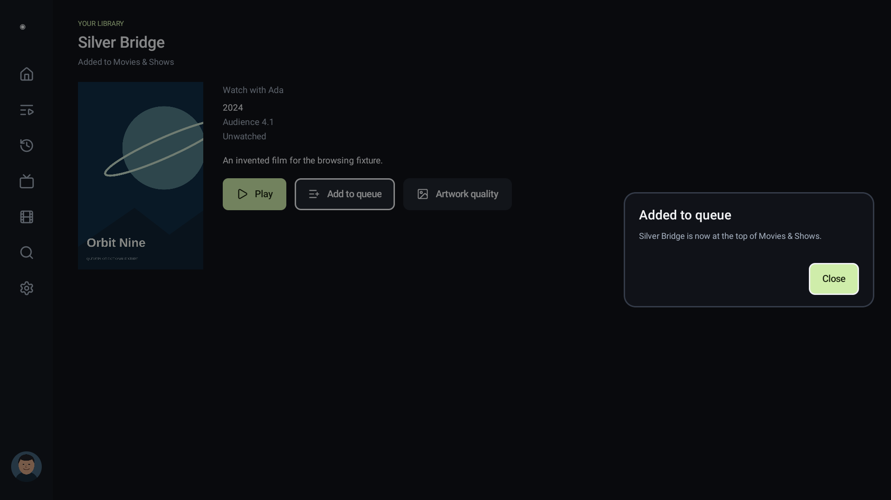

# Library browsing

Version 0.5.5-preview, version code 10. Verified 2026-10-23.

`aapt2 dump badging` reports
`package: name='dev.queuepilot.player.prototype' versionCode='10' versionName='0.5.5-preview'`.
The application ID is unchanged, so this updates the installed preview in place. Home stays queue-first: nothing in this release is on Home. The
release uses the 0.5.4 colors, type styles and shared components; the restyle is not chosen
yet. Screenshots show invented fixture data only.

## Infinite scroll

A library section is one grid that keeps loading. There are no page buttons. A page is about
48 titles and always whole rows (50 at five columns). The next page is requested when focus is
within three rows of the last loaded row, so it is there before focus reaches it; appending
rows never moves focus. Back from a title restores the grid around that title, however deep in
the library it was, and focuses it again.

The status line gives the library's total from the server's `totalSize` and the sort:
"305 titles · Sorted by Title". A saved listing still reads "Saved listing · your server is
currently unavailable" when the server is down.

| Before (0.5.4: 30 per page, Next page) | After: title order, the letter bar |
| --- | --- |
|  |  |

## Jump by letter

In title order a **# A–Z** bar runs down the right edge. It comes from the section's
`/library/sections/<key>/firstCharacter` index, so a letter with no titles is not offered, and
"#" holds titles that start with a digit. The cells shrink to fit the screen height, so every
letter fits at 1080p, density 320, and any Display size. A letter starts the grid at its first
title (the offset is the sum of the counts before it, rounded down to a row) and focuses that
title. The page above loads at once, and the scroll position is corrected so the title does not
move; Up then continues into the previous letter. The bar marks the letter of the focused title.
Right from the last column reaches the bar; Left returns to the grid.

| Jump to M | Density 320 |
| --- | --- |
|  |  |

## Sort

**Sort** in the library header opens a side panel with Lucide icons: Title (`titleSort`),
Recently added (`addedAt:desc`), Release date (`originallyAvailableAt:desc`), Rating
(`audienceRating:desc`), and Last watched (`lastViewedAt:desc`). The choice is stored per
library, profile, and server, and survives a restart. The letter bar shows only in title order.

| Sort panel | Recently added |
| --- | --- |
|  |  |

## Search

**Search** is a rail entry (seven entries now: Home, Watching, History, Series, Movies, Search,
Settings) and a button in each library's header, which searches that library alone
(`sectionId`). The field takes the on-screen keyboard and searches as the viewer types (after
450 ms) or on Enter. **Voice** appears when the device has a speech recognizer; it fills the
field with what was heard. Results come from `/hubs/search` and are grouped as Movies, Shows,
and Episodes; a result opens the existing title screen, and Back returns to the same results.

## Add to queue

A title screen has **Add to queue**; a show's season list has one in its header. An episode
is added as its show ("Add the show Orbit Nine to a queue"), because a queue holds movies and
shows. The side panel lists the Picks queues that play as the active profile, with the audience
as on the queue cards. A Rules queue chooses its own titles and a queue that plays as another
profile refuses this one, so neither is offered, and the panel says why in a note. The title
goes to the top of the chosen queue. A title already there reports "Already in this queue"
instead of adding a second line.

The request is `POST /api/native/queues/:setId/items` `{ratingKey, plexServer}` with the
profile's `X-Plex-Profile-Token`. That route is new in QueuePilot (Sawtaytoes/queuepilot #364,
merged as `5cca973`); it uses the same authorization as starting the queue and the web app's
own add, duplicate guard, and shared-server check.

| Panel | Added |
| --- | --- |
|  |  |

## Lucide icons

Eight icons were added from the same pinned `lucide-static` 1.61.0 release: arrow-up-down,
arrow-down-a-z, calendar-plus, star, search, list-plus, mic, and chevron-right. The release's
calendar-plus writes its arc flags without separators (`a2 2 0 00-2-2`), which VectorDrawable
cannot read; `generate.py` now spells them out, and only for an arc that needs it.

## Gates

All 76 unit tests, Android lint (0 errors), and APK assembly passed. `library_smoke.py` is new
in `tools/tv-checks.sh` and drives every section above against the fixture's 305-title Archive
library, reading each expected order from the fixture: the count line, the letter bar against
the first-character index and the screen, Down through more than one page with focus on the
expected title in every row and no paging buttons, Jump to M with the title kept on screen and
Up into L, Back to a title deep in the library, Add to queue with both notes, an add, a
duplicate, the request body, and an episode added as its show, the four other sorts with
Recently added kept across a restart, search grouped by type from the rail and from the header
with `sectionId=3`, and the letter bar at density 320. The full emulator regression result is
recorded below.

The full emulator regression (`tools/tv-lab.sh test library-browsing`, which runs
`tools/tv-checks.sh` on a fresh emulator with this APK) exited 0 on the first run. Every
check printed PASS: `smoke.py`, `native_smoke.py`, the 240/320 dpi side panels, markers,
queue-first Home, Display size at 70/100/125%, the rail (now with Search), details and seek
previews, the full queue and history, `library_smoke.py`, and native 1920x1080 browsing.

Not verified: a real Plex server's `firstCharacter`, `/hubs/search` and sort results, voice
search with a real recognizer, the add route against the deployed QueuePilot server (it is
merged, not deployed), and any physical Android TV. No physical device was used.

APK SHA-256: `c91c6d3f6739666f978afff63a0ea9aaf8c6a98142776c8dd881afb115f733e5`.
Ship the corresponding native-source/relink archive with this APK.
