# Every queue without a profile choice, the TV PIN, and a flowing full-queue grid

Version 0.5.6-preview, version code 11. Verified 2026-10-23 in the QueuePilot Test emulator
only. Screenshots show invented fixture data only.

`aapt2 dump badging` reports
`package: name='dev.queuepilot.player.prototype' versionCode='11' versionName='0.5.6-preview'`.
The application ID is unchanged, so this updates the installed preview in place.

This release needs the QueuePilot server change that plays each native queue as its own
profile and adds the TV PIN (Sawtaytoes/queuepilot #365). Against an older server the TV still
plays every queue, with the chosen profile's access, and nothing is locked.

## No profile choice in front of a queue

Sign-in opens the signed-in account's own Plex profile and goes straight to Home. The profile
picker is one press away on the rail avatar. Home lists every queue in the server's order, in
one group. Each card names its audience and says whom the queue plays as ("Plays as Grace") as
information only. There is no "Switches profile" group, no "Switch to that profile" on the full
queue, and no "Play as … Switch and play" dialog.

The server plays each queue as the profile the queue names. A new session hands the TV that
profile's grant for each server, and the TV streams the queue's items with it. The emulator
check chooses Grace, plays a queue that plays as Ada, and reads the fixture's request log: the
item and the video were requested with Ada's grant.

| Before (0.5.5): the picker after sign-in | After: Home after sign-in |
| --- | --- |
| 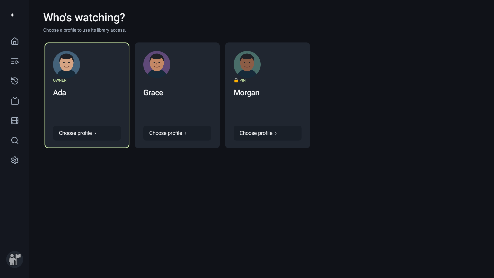 | 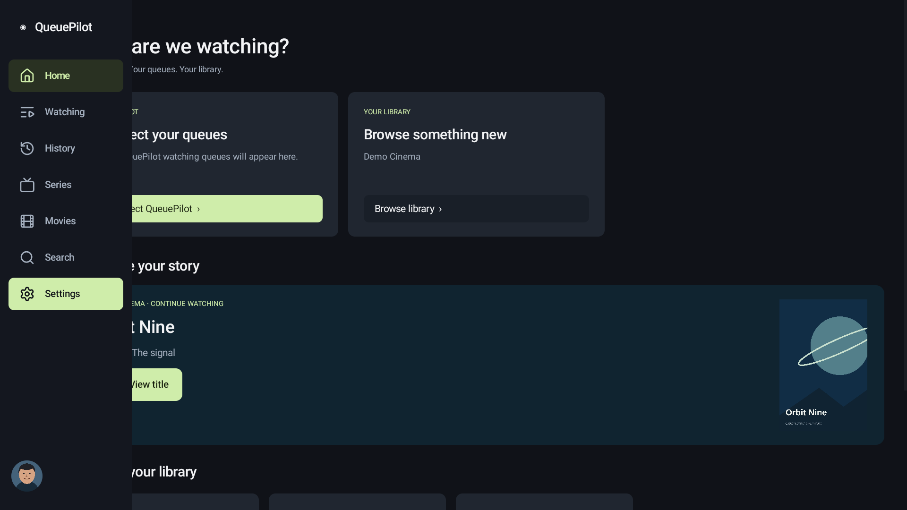 |

| Before (0.5.5): Home grouped by profile | After: every queue, "Plays as", and a lock |
| --- | --- |
| 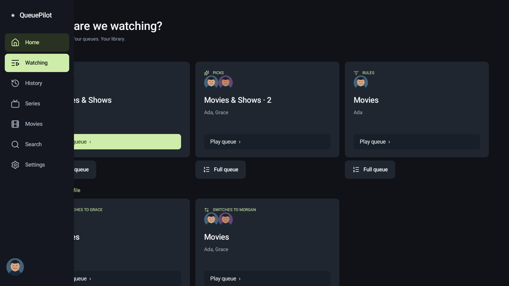 | 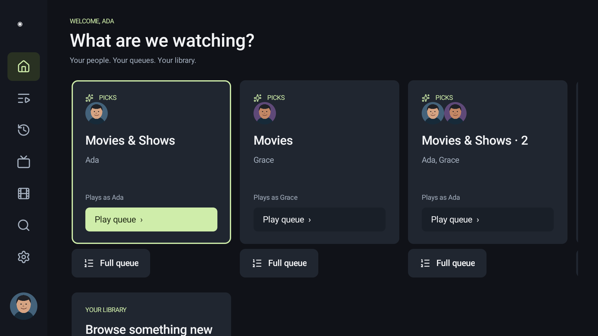 |

| Before (0.5.5): the full queue asked for a switch | After: the same queue opens |
| --- | --- |
| 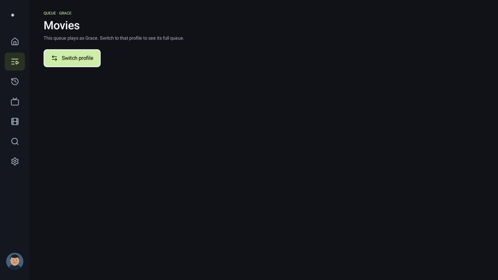 | 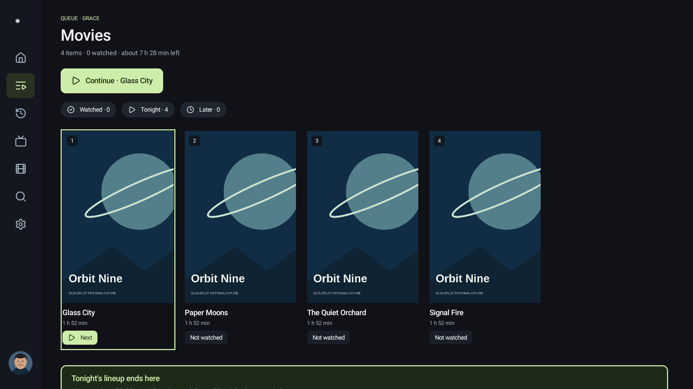 |

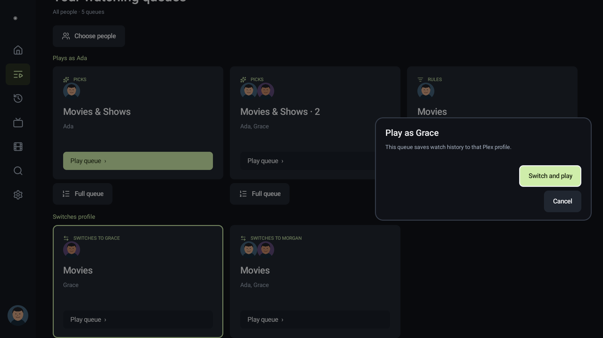

## The chosen profile still governs everything outside queues

Library browsing, search, title screens, a single title played outside a queue, and the server's
own continue row use the profile chosen on the rail avatar: its token, its restrictions, and its
watch history. The emulator check plays a library title with Grace chosen and finds Grace's
token on the item and video requests, right after a queue played with Ada's grant.

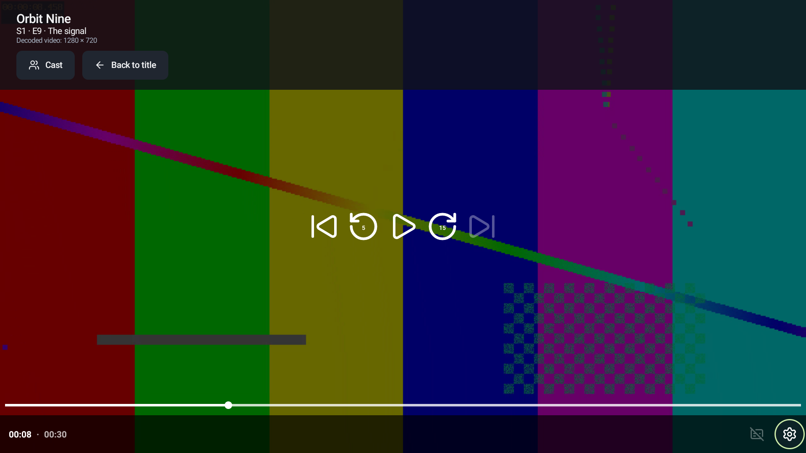

## Locked queues and the TV PIN

A queue marked "Locked on TV" in QueuePilot carries a lock on its card. Opening, playing, adding
to, or marking an item of it asks for the household TV PIN on a number pad. The pad works with
the D-pad and with the remote's number keys, and takes 4 to 8 digits. A wrong PIN says how many
tries are left. After five wrong PINs every try waits 60 seconds. The right PIN plays the queue
as its own profile, and the unlock rides on later requests. The unlock ends when the app leaves
the foreground; the check presses Home, returns, and is asked again. The server enforces the
lock (423 without an unlock), and History counts the locked queues it left out.

| The number pad | A wrong PIN | Five wrong PINs |
| --- | --- | --- |
| 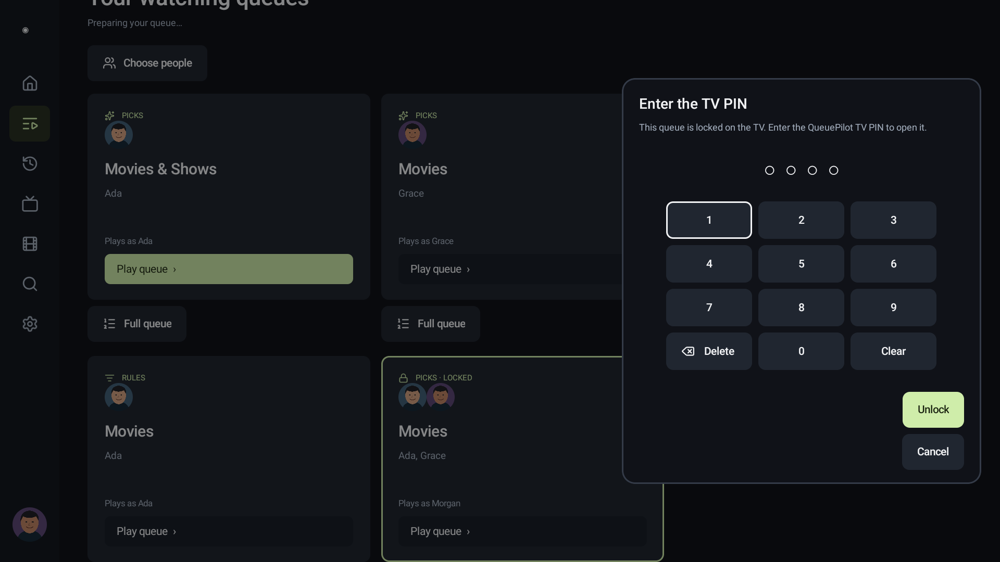 |  | 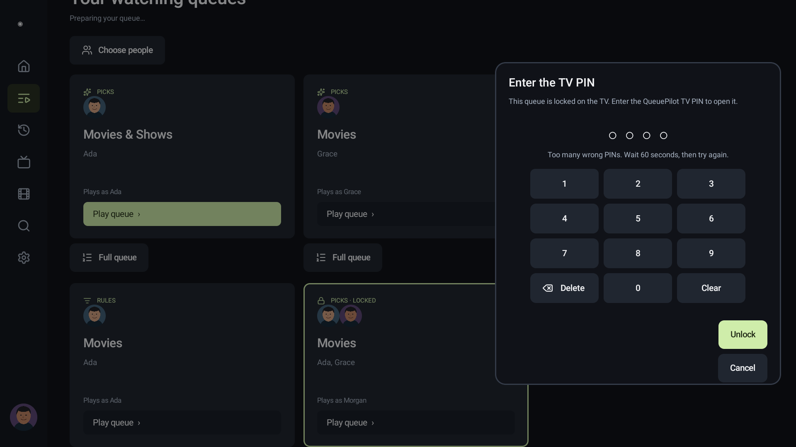 |

| Locked full queue after leaving the app | Unlocked full queue |
| --- | --- |
| 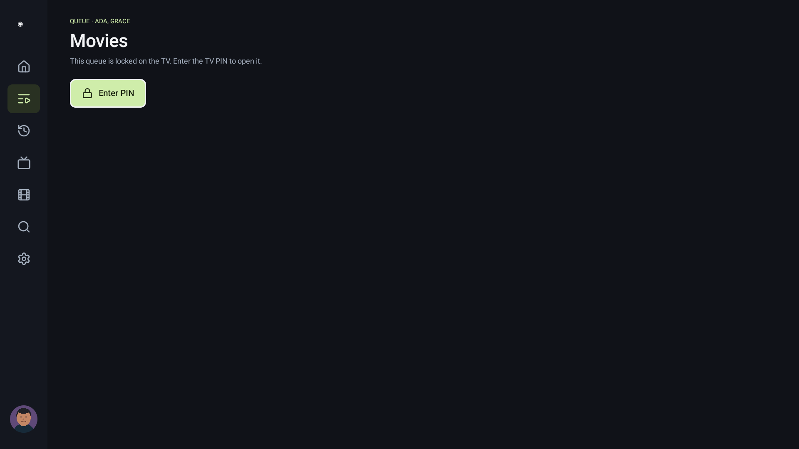 | 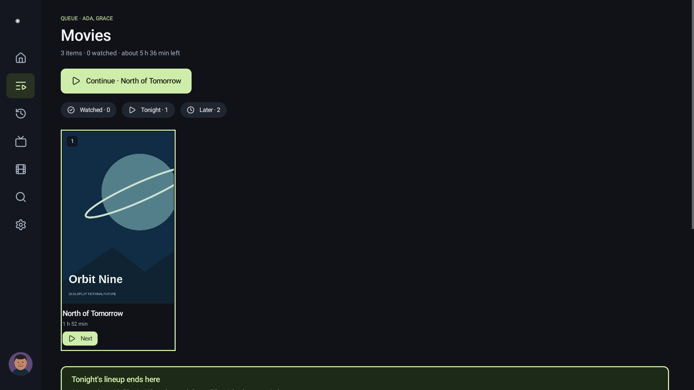 |

Add to queue now lists every Picks queue, whoever it plays as; the locked one carries its lock.

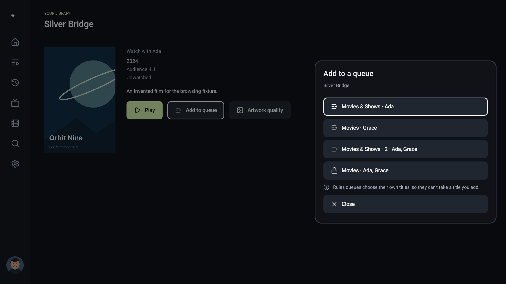

## One wrapping full-queue grid

The movie grid flows the items of every entry into one wrapping grid of square-cornered
posters. Only an entry with more than one item gets a heading. The next item is marked by its
"Next" badge instead of a line that broke the row, and "Tonight's lineup ends here" still
divides the grid. The fixture's movie queue now has seven one-film entries after the lineup.
In 0.5.5 each drew its own heading and its own row, one poster per row. In 0.5.6 they share
rows: 5 posters at 100% Display size and 4 at 125%. The check asserts at least three posters
from different entries on one row at both sizes. The list layout is unchanged.

| Before (0.5.5): one poster per row | After: 100% | After: 125% |
| --- | --- | --- |
| 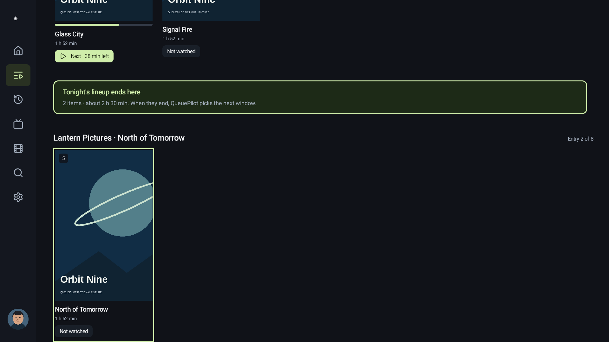 | 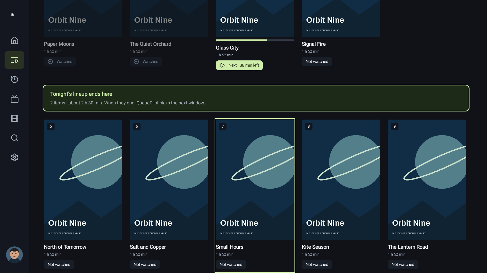 | 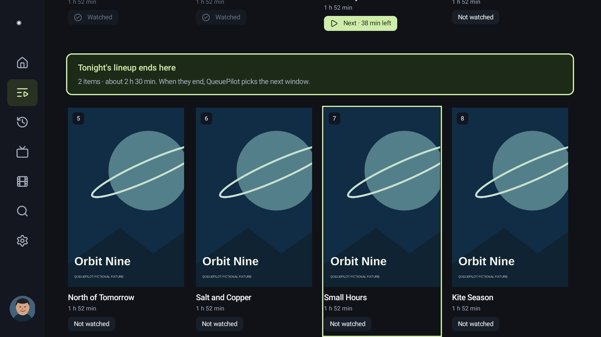 |

## Now playing on other devices

The Unfolded Circle Remote 3 shows the Shield's now-playing item through its Android TV
integration, which reads the Shield's Cast media status (its image is the status's first image
URL). Android fills that status from the playing app's media session. Until 0.5.5 the session
carried a title and subtitle and no artwork, so the remote fell back to an app icon.

0.5.6 fills the media session with one title line that carries the show, number, and episode
title ("Orbit Nine · S1 E9 · The signal"), the episode line as subtitle, the show as artist,
the season as album, the media type, and the poster twice: as image bytes fetched with the
playing grant, and, for a title on QueuePilot's own Plex server, as QueuePilot's tokenless
poster address (`/api/thumb/<key>`, the show's key for an episode). No Plex address is
published, because it would carry a token. The emulator reads
`metadata: size=13, description=Orbit Nine · S1 E9 · The signal, S1 · E9 · The signal, null`
from `dumpsys media_session` and finds the poster request made with the queue's grant.

Not verified: whether the Shield's Cast bridge copies the artwork into the Cast status's image
list, and whether the remote then shows it. That needs a physical Shield and the remote, which
this work did not touch.

## Gates

Unit tests, Android lint, and `assembleDebug` passed in the build container. The full emulator
suite (`tools/tv-checks.sh`) passed, including the new `household_smoke.py`.

Not verified: the live QueuePilot server (the server change is merged but not deployed), a real
library, the Remote 3, and any physical Android TV.
