# Look C and an automatic Display size

Version 0.5.7-preview, version code 12. Verified 2026-10-23.

The application ID is unchanged, so this updates the installed preview in place. The layout and
behavior are unchanged: this release changes colors, type, focus, and sizing only, and adds the
Auto Display size. Screenshots show invented fixture data only.

## Look C

The interface now uses the QueuePilot web app's theme: Charcuterie's `daylight` variant in the
dark scheme, with Charcuterie's categorical Lime as the accent in place of the web app's indigo.
Every value comes from `resolveTokens({ scheme: "dark", variant: "daylight" })` in the
Charcuterie source (`packages/tokens/src`, commit `33891c2`).

| Role | Token | Value |
| --- | --- | --- |
| Page, collapsed rail | `surface.base` | `#131822` |
| Cards, rows | `surface.raised` | `#1D2430` |
| Side panels | `surface.overlay` with a `border.default` edge | `#252D3B`, `#2E3745` |
| Text | `content.primary`, `content.secondary` | `#EDF0F5`, `#A9B2C1` |
| Inactive rail entries | `content.muted` | `#8B94A5` |
| Secondary buttons, chips, current rail page | `intent.neutral.surface` | `#222A37` |
| Primary buttons, focused rail entry | `categorical.4.solid` with `categorical.4.onSolid` | `#73A40A`, `#0C1204` |
| Accent text, icons, progress, focus ring | `categorical.4.content` | `#A3CF68` |
| Resume card, next item, selected panel row | `categorical.4.surface` | `#1F2910` |
| Card edge at rest | `border.subtle`, 1 px | `#212936` |
| Open rail | `elevation.high` over `scrim` | `rgb(6 9 16 / 0.66)` |
| Radii | `radius.md` buttons, `radius.lg` cards, `radius.xl` panels, `radius.none` posters | 8, 10, 14, 0 dp |

The focus ring is 3 dp, the proposed `tv` density's width, and a focused card is raised by
`elevation.medium`. Two parts of look C are not applied, because Android Views draw them
differently: the 3 px ring **offset** (a View draws its ring inside its own bounds) and the 4%
**lift** (a scaled card is clipped by its row at the screen edge). Both stay on the Charcuterie
gap list.

`TvTheme.java` holds every color, each named after its token. `TvUi.BG`, `PANEL`, `MUTED`,
`ACCENT`, and `WHITE` remain as short names for theme roles. `MainActivity.java` and
`TvPanel.java` now refer only to theme constants. The window background and platform accent in
`res/values/colors.xml`, and the launcher banner, use the same values. The fictional demo
artwork's colors also moved into `TvTheme`, labeled as picture content.

## Outfit

The typeface is Outfit, Charcuterie's `font.sans`. Charcuterie ships it as WOFF2, which Android
cannot read, so the variable TTF is bundled from `google/fonts` at a pinned commit, with its SIL
Open Font License (`tools/fonts/OFL.txt`, `tools/fonts/fetch.sh`, SHA-256
`fc7287273e66929776e2ba54f144fe699080bec29f61bf649d70d871468aeade`). `res/font/outfit.xml` names
weights 400, 500, and 600 on the one file. The shared text helpers apply it, and the window theme
sets it for every other text view. The screenshots show it loaded: Outfit's single-story `a`,
and round `g` replace Roboto's in every label.

## Display size: Auto

Settings → Display size lists **Auto** first, then 50% to 125% in 5% steps. Above the list,
**Screen** and **Distance** take the screen's diagonal in inches (20 to 150) and the viewing
distance in feet (2 to 30); each opens a number field, and Enter saves. The defaults are 55 in
and 9 ft, which is Auto · 95%. Auto computes:

```text
width = diagonal x 16 / sqrt(16^2 + 9^2)
angle = 2 x atan(width / 2 / (distance x 12))
scale = sqrt(22.6 / angle), rounded to 5%, kept within 50% and 125%
```

22.6° is a 55 in screen at 10 ft, which is 100%. **A 97 in screen at 6.5 ft is 56.9°, so Auto is
65%.** Settings shows "Display size · Auto · 65%". A stored 70, 80, 90, 100, 110, or 125 from
0.5.2 to 0.5.6 is still a manual choice. Grids gain columns at smaller sizes: Films shows 8
columns at Auto 65% and 5 at 100%.

The type is also smaller at 100%. Sizes up to 16 sp are reduced by a fifth, and each sp above 16
counts 0.55, so a 34 sp page title is 22.7 sp, a 23 sp card title is 16.7 sp, and a 16 sp label
is 12.8 sp (0.5.5 drew them at 29.2, 19.8, and 13.8). Buttons are 40 dp high instead of 46, and
cards have 18 dp padding instead of 22. Posters stay square.

| Before (0.5.4 and 0.5.5) | After, 100% | After, Auto · 65% (97 in, 6.5 ft) |
| --- | --- | --- |
| 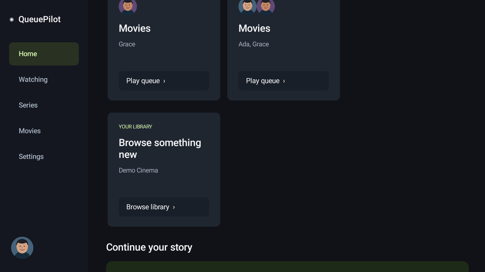 | 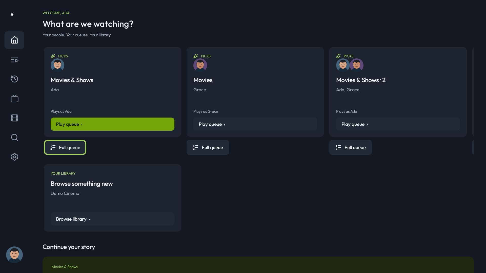 | 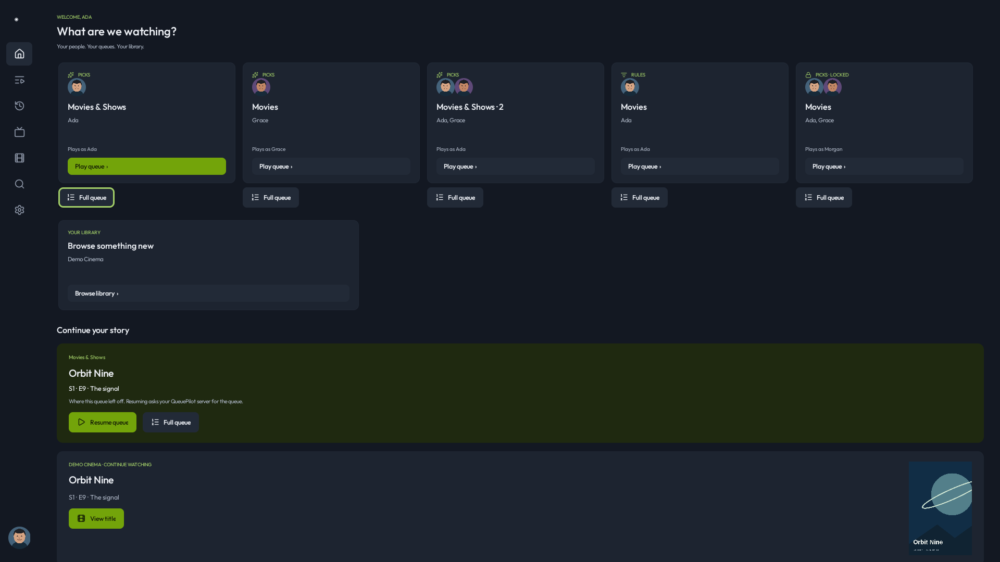 |
| 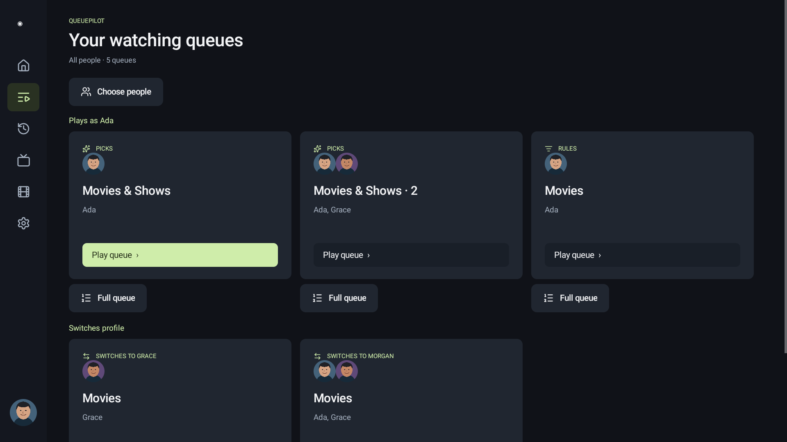 | 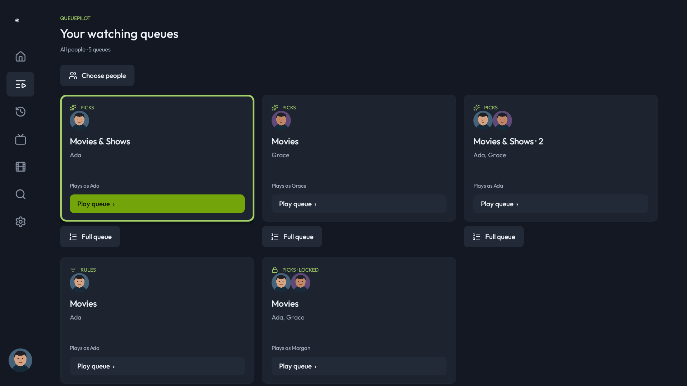 | 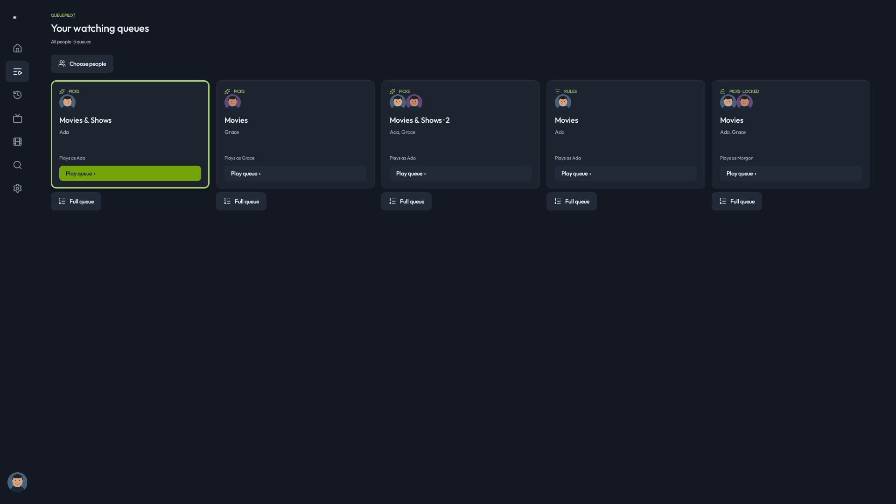 |
| 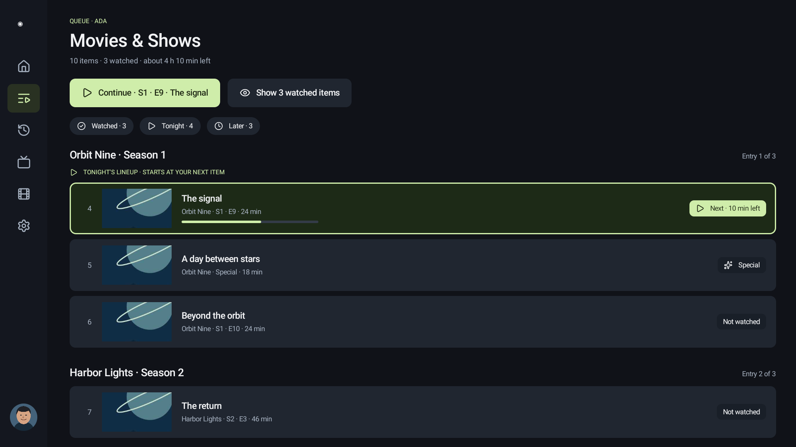 | 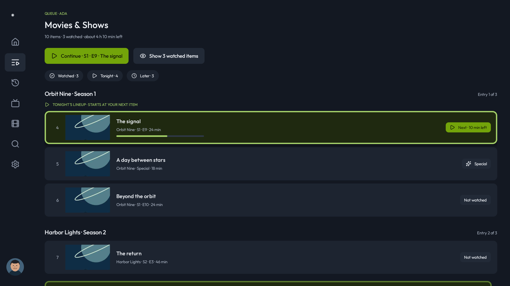 | 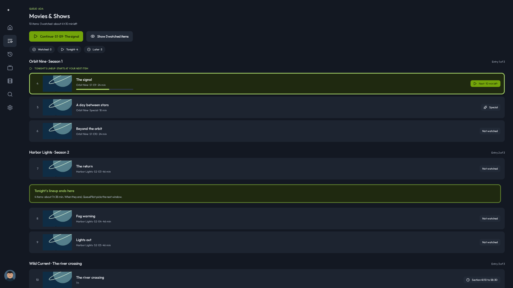 |
| 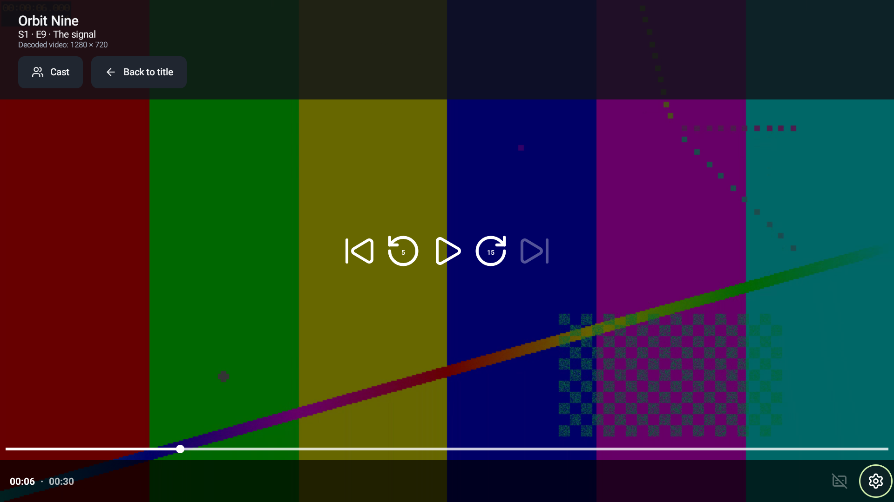 | 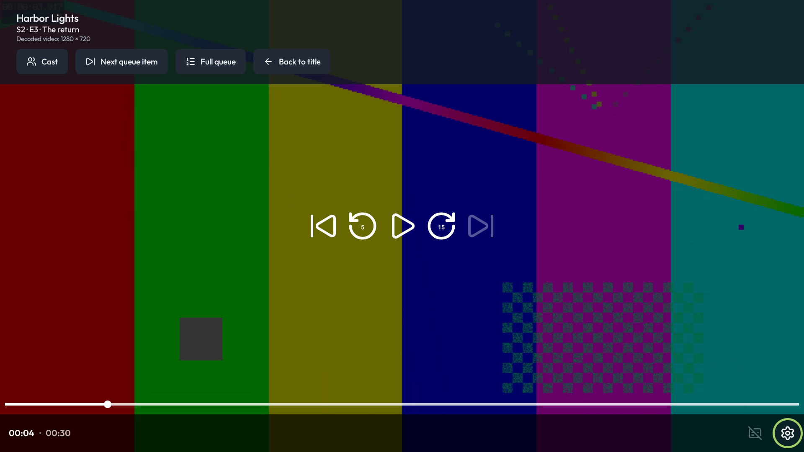 | 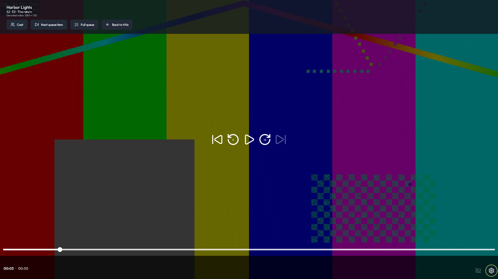 |
| 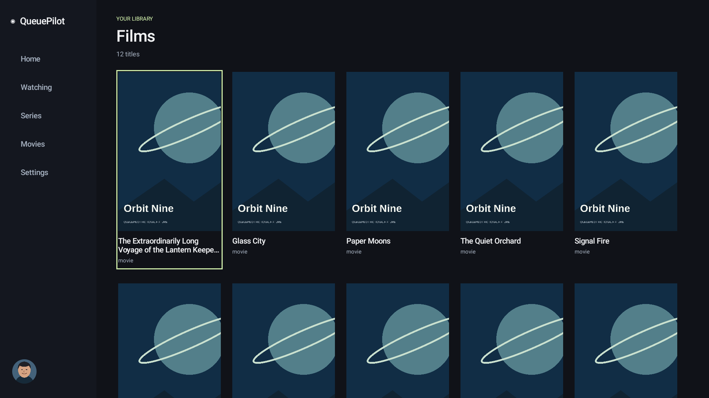 | 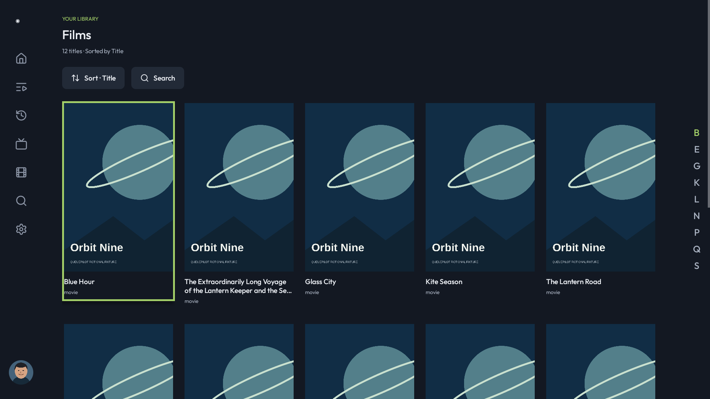 | 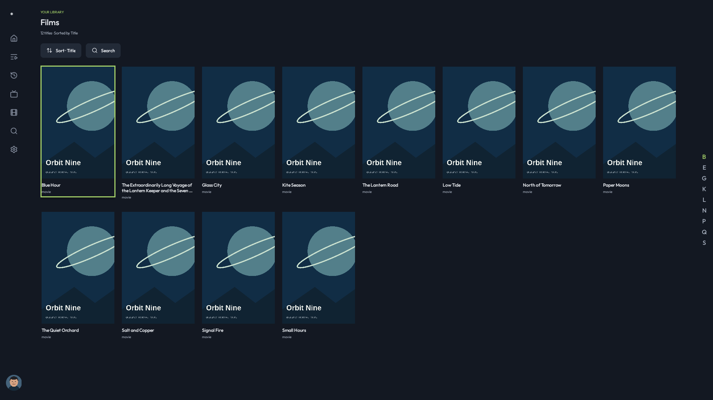 |
| (0.5.5 listed six sizes) | 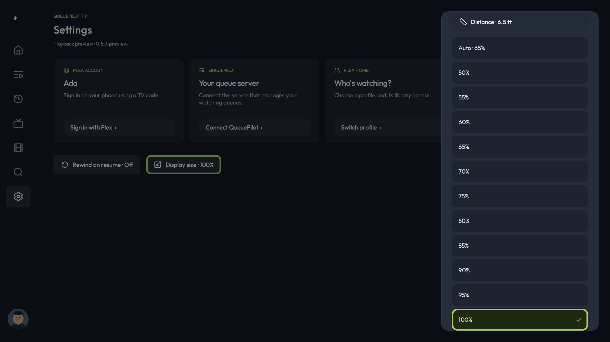 | 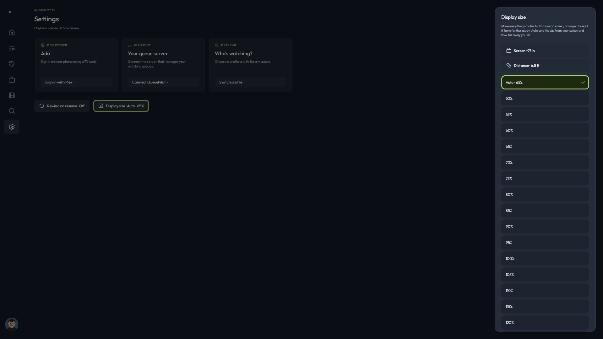 |

## Gates

- **Unit tests**: `DisplaySizeTest` covers Auto (65% for 97 in at 6.5 ft, 95% by default, 100%
  at 55 in and 10 ft, the 50% and 125% limits), out-of-range inputs, the 5% steps, the stored
  sizes of earlier releases, and the column counts.
- **`tools/theme_check.py`** runs first in `tools/tv-checks.sh`. It fails on any 8-digit hex int,
  `Color.rgb`/`argb`/`parseColor`/`valueOf`, or named `Color` constant other than `TRANSPARENT`
  outside `TvTheme.java` (the three binary-format parsers are skipped), on an XML color that is
  not a theme color, and on a change to Auto's formula or defaults. Run against 0.5.5's sources
  it reports 50 literals.
- **`tools/restyle_smoke.py`** enters 97 in and 6.5 ft with the remote, checks "Auto · 65%" in the
  panel and in Settings, that Auto is stored as Auto, that the Films grid has more columns at Auto
  than at 100%, and that the focus ring is `#A3CF68`, and takes the screenshots above.
- **`tools/display_smoke.py`** now expects Auto · 95% as the default and the lime ring.

Results on this branch, rebased on 0.5.6 (`847eea6`):

- `tools/build.sh`: 81 unit tests with 0 failures, lint 0 errors (119 warnings), and the debug
  APK built.
- `tools/tv-lab.sh test`: the full emulator suite passed, with 17 PASS lines and exit 0,
  including 0.5.6's `household_smoke.py` and the new `restyle_smoke.py`. One earlier run failed
  in `smoke.py` while another session installed a different APK over the one under test; the
  next run found that `restyle_smoke.py` still waited for the profile question that 0.5.6
  removed, and now waits for the queue card's "Plays as" line instead.

Not verified: any physical Android TV. No physical device was used. The type and spacing at
Auto on a real 97 in screen at 6.5 ft are computed, not observed.
