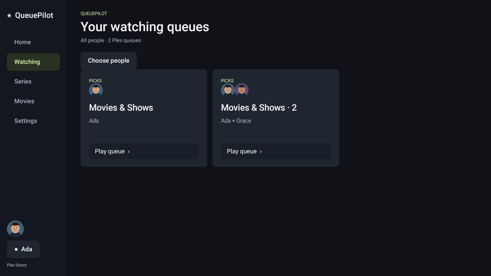
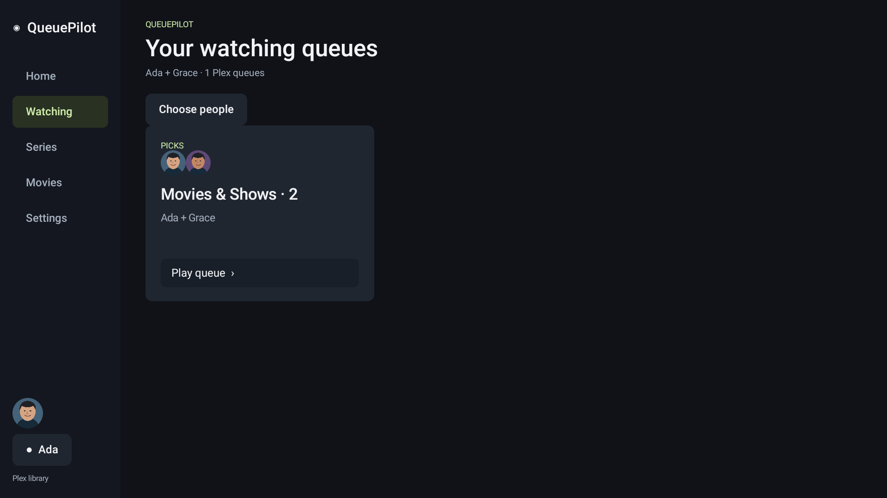
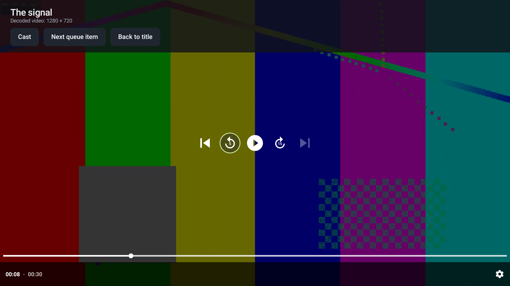

# Native queues, cast pictures and playback history

Version 0.3.0 adds native Plex queue starts, a Plex-only queue browser, the existing audience
filter, profile avatars, cast portraits with roles, progress reporting and configurable resume
rewind (default three seconds). The seek controls retain their arrows and interval labels
while using the same rounded focus treatment as the other controls.

## Validation

All 15 Java unit tests, Android lint and assembleDebug pass. The backend's 496 server tests
pass, including real profile binding, capability hashing, idempotent events, safe direct
grants, complete episode batches and fresh watched-count baselines for repeated files.
The emulator sign-in/profile/library smoke check passed on 2026-10-12. The native playback smoke check also passed: Plex-only queues, audience persistence,
cast faces/roles, D-pad rewind focus, three-second rewind, encrypted offline progress retry,
next-item playback, natural completion and restart. Native 1920×1080 layout checks also passed at density 240 and density 320,
including artwork-row browsing. The fresh crash log contained no fatal exception. No real household data is used in screenshots.

The inspector test APK is separate from the viewer APK. It reads accessibility snapshots
without waiting for playback animation to become globally idle and refuses physical TV targets.

APK SHA-256: `e3419a7455551ebef5345dc2bc2abfbbcfbdc5900106cdaec54356a87e9f5bba`.

## Native screenshots

## Scope and limits

Progress is attributed to the verified Plex profile; queue-owned history uses the existing
QueuePilot policy. Pending native events are encrypted and retried, with invalid/expired
grants retained for review. Direct library progress currently has no durable offline retry.
Queue snapshots and people filters survive restart; an active lineup is not restored after
app termination. Protected-profile switching requires an online PIN check.

Cast is title metadata, not scene-timed recognition. Faithful large ASS subtitles, server
transcoding, HDR conversion, Dolby Vision and passthrough still require separate work or
physical-device evidence. Native 4K UI remains unverified; the earlier emulator experiment
and [0.2.0 validation](verification-0.2.0.md) remain available. These changes do not alter
Android display overrides or force a Shield resolution.
