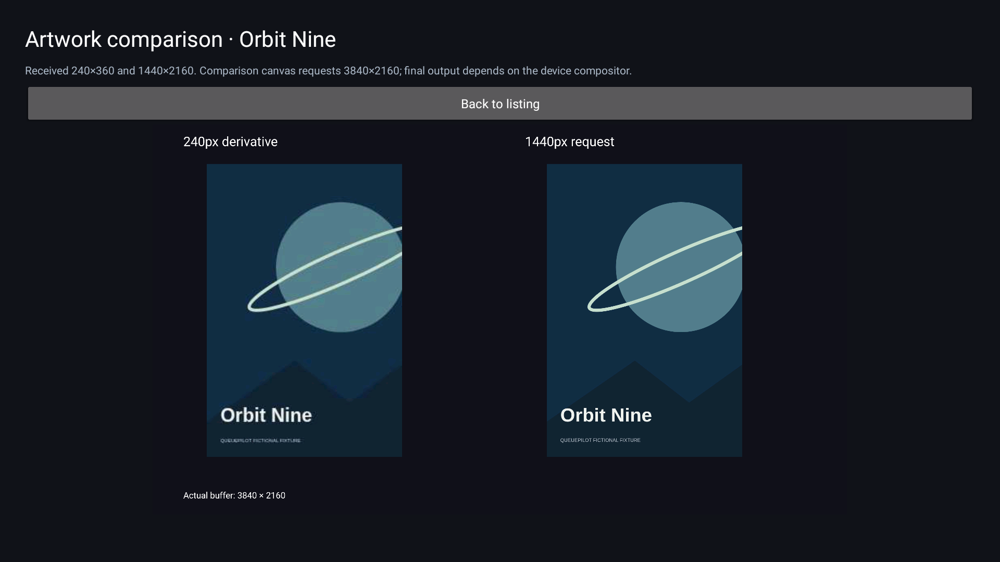
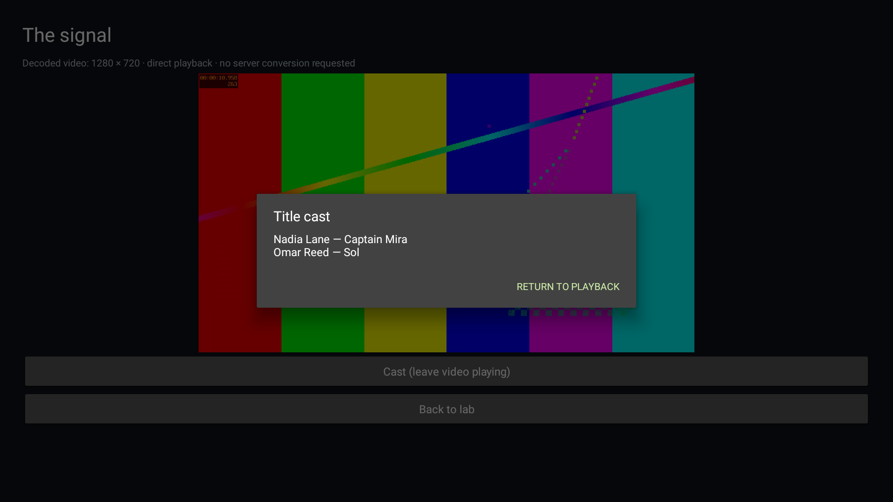
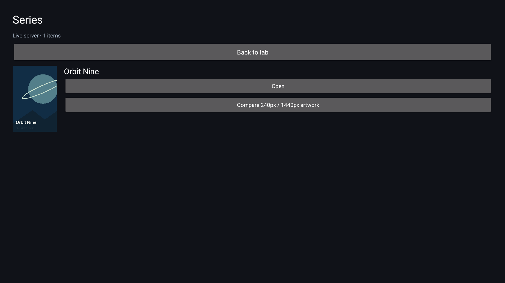
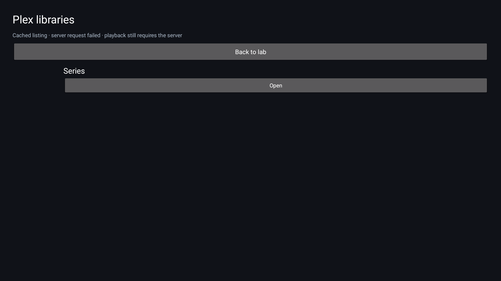

# Prototype validation October 9 2026

QueuePilot Lab 0.1.0 is a tested Android TV diagnostic APK, not a replacement family
player. Android lint and all seven unit tests passed. A headless Android TV API 30
emulator booted using KVM, with a physical 1920 × 1080 hardware profile, four virtual
CPUs, and SwiftShader graphics. The toolchain resolved Android Emulator 37.2.12 and
Platform Tools 37.0.1.

The complete synthetic-server smoke check passed enrollment, encrypted token storage,
D-pad focus, live catalog traversal, larger artwork requests, real H.264/AAC playback at
1280 × 720, cast without exiting playback, process restart, demo OVA ordering, independent
profile progress, local profile switching while the fixture origin was unavailable,
and profile-scoped cached listings. The crash buffer contained no fatal exception.

The artwork screen initially stretched its 4K comparison buffer. It was corrected to
preserve a 16:9 surface and tested again after rebuilding. The final screenshot shows
received images of 240 × 360 and 1440 × 2160, and a 3840 × 2160 canvas buffer. The emulator
screenshot is 1920 × 1080. These are separate dimensions; this does not prove the Shield
compositor will deliver the whole interface at native 4K.

Final APK SHA-256:

```text
4ecda9be134b22d10a4e8fae9f8f4ed3bd26ffc428317c16ab2cacfec255f987
```

The fixtures are generated, fictional, and independent of a real media library. No
physical Shield or Roku was modified or used for these checks. Real Plex Home token
lifetime, faithful large ASS subtitles, HDR conversion, passthrough, full UI rendering,
and native QueuePilot starts remain separate acceptance gates.








